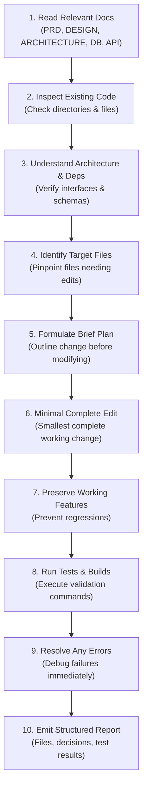

# AI Agent Development Instructions (AGENTS.md)
# AgroGenius AI: Smart Agriculture Platform

**Document Version:** 1.0.0  
**Status:** Inviolable Project-Level Agent Guidelines  
**Project:** AgroGenius AI  
**Scope:** Mandatory rules and protocols for all future AI-assisted software development tasks.  

---

## 1. Purpose and Authority of this Document

This document defines the strict, binding operational rules, architectural constraints, and development workflows for any AI coding assistant or engineer working on **AgroGenius AI**.

### 1.1 Documentation Hierarchy & Sources of Truth
When implementing or modifying any component of AgroGenius AI, agents must treat existing documentation as the definitive source of truth in the following order of precedence:
1. [`PRD.md`](file:///c:/Users/Balram/Desktop/recommendation/PRD.md) — Product requirements, user journeys, feature specifications, and business rules.
2. [`DESIGN.md`](file:///c:/Users/Balram/Desktop/recommendation/DESIGN.md) — Visual design tokens, component anatomy, layout hierarchy, and UX states.
3. [`ARCHITECTURE.md`](file:///c:/Users/Balram/Desktop/recommendation/ARCHITECTURE.md) — System boundaries, service interfaces, ML lifecycle, and deployment topology.
4. [`DATABASE.md`](file:///c:/Users/Balram/Desktop/recommendation/DATABASE.md) — Relational PostgreSQL schema, constraints, migrations, and entity relationships.
5. [`API.md`](file:///c:/Users/Balram/Desktop/recommendation/API.md) — REST API contracts, JSON schemas, status codes, and authentication headers.
6. `AGENTS.md` (This document) — Development workflow, code safety, and quality enforcement.

*Rule:* If an instruction in a prompt appears to contradict these approved documents, the agent must document the discrepancy and request user approval before proceeding. Never silently overwrite or bypass approved specifications.

---

## 2. Verified Repository State & Directory Scaffolding

Before taking action, agents must understand the actual verified state of the repository at `C:\Users\Balram\Desktop\recommendation`:

```
C:\Users\Balram\Desktop\recommendation\
├── PRD.md                      # [VERIFIED PRESENT] Product Requirements Document
├── DESIGN.md                   # [VERIFIED PRESENT] Design System & UX Specification
├── ARCHITECTURE.md             # [VERIFIED PRESENT] Technical Architecture Specification
├── DATABASE.md                 # [VERIFIED PRESENT] PostgreSQL Database Schema Specification
├── API.md                      # [VERIFIED PRESENT] REST API Contract Specification
├── AGENTS.md                   # [VERIFIED PRESENT] AI Agent Development Instructions (This File)
│
├── frontend/                   # [VERIFIED PRESENT] Vite + React 19 Starter Template
│   ├── package.json            # React ^19.3.1, Vite ^8.3.5, Oxlint ^1.89.0
│   ├── vite.config.js          # @vitejs/plugin-react
│   ├── index.html              # HTML entrypoint
│   ├── src/                    # App.jsx, App.css, index.css, main.jsx, assets/
│   └── public/                 # favicon.svg, icons.svg
│
├── backend/                    # [VERIFIED PRESENT] Scaffolded directories (Empty)
│   ├── app/ (api, core, database, schemas, services)
│   └── tests/
│
├── ml-service/                 # [VERIFIED PRESENT] Scaffolded directories (Empty)
│   ├── data/ (raw, processed), models/, notebooks/, src/
│
├── datasets/                   # [VERIFIED PRESENT] Scaffolded domain directories (Empty)
│   └── crop-recommendation/, fertilizers/, seeds/, shops/, soil/, weather/
│
└── docs/                       # [VERIFIED PRESENT] Empty directory
```

*Rule:* Do not claim that backend endpoints, database tables, or ML pipelines are already implemented when inspecting this repository. They are verified scaffolds ready for disciplined, milestone-driven implementation.

---

## 3. Project Overview & Capabilities

AgroGenius AI is a smart agriculture platform designed to empower smallholder and commercial farmers with data-driven agronomic intelligence and connected marketplace services.

### Core Capabilities:
1. **ML-Based Crop Recommendation:** Predicts suitable crops from 7 soil and climate inputs ($N, P, K, pH$, Temperature, Humidity, Rainfall) using a trained Scikit-learn Random Forest model.
2. **Crop Suitability Explanations:** Explains recommendations through parameter-by-parameter biological envelope comparisons.
3. **Seed & Fertilizer Guidance:** Delivers certified cultivar specifications and calculated soil NPK deficit adjustment schedules.
4. **Weather Intelligence:** Ingests live weather and 5-day forecasts via Open-Meteo with zero-fabrication fallbacks.
5. **Cultivation Cost & Profit Estimators:** Parametric economic models calculating input costs, gross revenue, net profit, and sensitivity in Indian Rupees (₹ INR) per Acre.
6. **Agricultural Marketplace:** Allows farmers to discover verified agricultural inputs with stock and price transparency, protected by administrative listing moderation.

---

## 4. Technology Stack & Rules

Agents must adhere strictly to the approved technology stack:

- **Frontend:** React 19.x with Vite 8.x. Styling via native CSS custom properties adhering to `DESIGN.md`.
- **Backend:** Python 3.10+ with FastAPI and Uvicorn. Data validation via Pydantic v2.
- **Machine Learning:** Scikit-learn (Random Forest primary; Decision Tree baseline; XGBoost only if justified), Pandas, NumPy, and Joblib for serialization.
- **Database:** PostgreSQL 15+ accessed asynchronously via SQLAlchemy 2.0 and `asyncpg`. Migrations via Alembic.
- **API Protocol:** REST over HTTPS using standard JSON payloads under `/api/v1`.
- **Weather Service:** Open-Meteo REST API (server-side integration with 30-minute in-memory caching).
- **Hosting Targets:** Vercel (Frontend SPA), Render Web Service (FastAPI Backend), Render / Supabase Managed PostgreSQL.

*Rule:* Do **not** introduce alternative frameworks (e.g. Next.js, Django, Flask), alternative databases (e.g. MongoDB, SQLite for production, Redis for MVP), or alternative state managers (e.g. Redux, Zustand) without explicit user approval.

---

## 5. Mandatory 10-Step Development Workflow

Every AI agent performing implementation tasks must follow this sequential workflow:



1. **Read Relevant Documentation:** Review the specific sections of PRD, DESIGN, ARCHITECTURE, DATABASE, and API related to the task.
2. **Inspect Existing Implementation:** Check the actual code in the repository. Never assume a file or function exists without checking.
3. **Understand Architecture & Dependencies:** Confirm how the target module connects to other components.
4. **Identify Target Files:** Select only the exact files that require modification or creation.
5. **Formulate a Brief Plan:** Clearly outline the proposed changes before executing edits.
6. **Implement Minimal Complete Edits:** Write the smallest complete, functioning change that satisfies the requirement. Avoid premature refactoring.
7. **Preserve Existing Working Features:** Ensure untouched functionality remains operational.
8. **Execute Validation Commands:** Run builds, linters, and automated tests (e.g. `npm run build`, `pytest`).
9. **Resolve Regressions Immediately:** Fix any build or test failures introduced by the changes before concluding.
10. **Emit Structured Summary:** Report what was created/modified, tests executed, actual results, and remaining limitations.

---

## 6. Strict File-Safety Rules

- **Zero Blind Overwriting:** Never replace an entire existing file when a surgical, targeted edit using `edit_file` is sufficient.
- **No Unsolicited File Deletions:** Never delete existing source files, assets, or configs without explicit authorization.
- **Preserve User Configuration:** Maintain existing configuration settings (e.g., `.gitignore`, `.oxlintrc.json`, `package.json` scripts).
- **No Monolithic Generations:** Never generate the entire application codebase in one giant, uncontrolled step. Build incrementally in milestones.
- **Documentation Preservation:** Do not modify `PRD.md`, `DESIGN.md`, `ARCHITECTURE.md`, `DATABASE.md`, or `API.md` unless the user explicitly requests documentation updates.
- **Conflict Escalation:** If a requested implementation conflicts with established architecture, explain the conflict clearly rather than making unauthorized architectural changes.

---

## 7. Frontend Development Rules (React + Vite)

- **Design System Adherence:** Follow [`DESIGN.md`](file:///c:/Users/Balram/Desktop/recommendation/DESIGN.md) strictly for color tokens (`--bg-app: #081a10`, `--bg-surface: #0f291b`, `--accent-primary: #22c55e`), typography scales, spatial increments (8-point grid), and elevation shadows.
- **Zero Generic SaaS Styling:** Avoid neon glow effects, floating gradient blobs, excessive glassmorphism, or AI-generated SaaS card clutter. Maintain a clean, professional agricultural aesthetic.
- **Frictionless Farmer Experience:** The crop recommendation input and results flow must remain **completely accessible without login**. Never gate recommendations behind a registration modal.
- **Two-Tier Form Validation:** Implement instant client-side boundary validation on inputs ($N, P, K, pH$, Temperature, Humidity, Rainfall), but treat backend HTTP 422 responses as the ultimate authority.
- **State Preservation:** Use `window.sessionStorage` (via `useSessionStorage` hook) to preserve entered soil metrics against accidental mobile browser refreshes.
- **Mobile Usability & Accessibility:**
  - Minimum touch target: $48\times 48\text{px}$ for all mobile buttons.
  - Virtual keypad trigger: Numeric inputs must use `inputMode="decimal"` or `inputMode="numeric"`.
  - Color contrast: Maintain WCAG 2.1 AA contrast ratio ($\ge 4.5:1$ for normal text, $\ge 3:1$ for headings).
- **Client Secrets Protection:** Never store or expose API keys, database credentials, or server secret tokens in frontend code. Only `VITE_` prefixed variables are permitted for public endpoints.
- **Zero Fabrication:** Never display synthetic dummy prices (`$99.99`), fake weather readings (`72°F Sunny`), or hardcoded prediction metrics in production UI components.

---

## 8. Backend Development Rules (FastAPI)

- **Layered Architecture:** Route handlers in `backend/app/api/v1/endpoints/` must remain thin. Place business logic in `backend/app/services/` and database queries in repositories or service methods.
- **Pydantic v2 Validation:** Every endpoint must define strict typed Pydantic models for incoming requests and outgoing responses in `backend/app/schemas/`.
- **Global Error Handling:** All unhandled exceptions must be caught by a centralized error handler returning standardized JSON envelopes per `API.md`. Never leak Python tracebacks, internal file paths, or raw SQL queries to API clients.
- **Defensive Server-Side Security:** Never rely on frontend validation for security. Enforce all constraints, boundary checks, and authorization rules on the server.
- **Role-Based Access Control (RBAC):**
  - Public routes: `/recommendation/predict`, `/advisory/*`, `/weather/*`, `/economics/*`, `/marketplace/products`.
  - Merchant routes (`role: "shopkeeper"`): `/merchant/products/*`, `/merchant/profile`.
  - Admin routes (`role: "admin"`): `/admin/products/*`.
- **Resource Ownership Guards:** When a merchant updates or archives a product listing, the query must strictly verify:
  `WHERE products.id = :product_id AND merchant_profiles.user_id = :current_user_id`
- **Health Probes:** Maintain `/health` (liveness) and `/health/ready` (readiness verifying ML model in RAM and database pool availability).

---

## 9. Machine Learning Rules

Machine learning is the core intelligence component of AgroGenius AI. The following rules are non-negotiable:

- **Real Agricultural Dataset:** Training must use a verified agricultural dataset (`datasets/crop-recommendation/Crop_recommendation.csv`) containing real records across standard crop labels.
- **Data Inspection Protocol:** Before training, inspect the dataset to verify column names, null counts, duplicate rows, data types, and class distributions.
- **Feature Schema Invariance:** The model requires exactly 7 input features in strict order:
  `['N', 'P', 'K', 'temperature', 'humidity', 'ph', 'rainfall']`.
  Feature names and order must be identical during training and inference.
- **Zero Target & Data Leakage:**
  - Preprocessing scalers or encoders must be fit **only** on the training set (never on the full dataset before splitting).
  - Use stratified train-test splits ($80\%$ train, $20\%$ test) to maintain balanced class representation across all 22 crops.
- **Model Comparison & Metrics:**
  - Train and compare `DecisionTreeClassifier` (baseline) and `RandomForestClassifier` (primary). Evaluate `XGBoost` only if Random Forest fails to achieve target accuracy or latency.
  - Required evaluation metrics: Test Accuracy ($\ge 95.0\%$ target), Macro Precision, Recall, F1-score, and Confusion Matrix.
- **Model Serialization & Metadata:**
  - Serialize the trained pipeline using `joblib` into `ml-service/models/crop_recommendation_model.joblib`.
  - Accompany the artifact with `model_metadata.json` recording training timestamp, features, test metrics, and library versions.
- **In-Memory Inference:** At FastAPI startup (via lifespan event), load the model artifact as a singleton. Inference must execute in-memory with sub-250ms latency.
- **Strict Anti-Fabrication Rule:**
  - **NEVER** return hardcoded crop predictions or mock probabilities.
  - **NEVER** fabricate dataset properties, model accuracy scores, or evaluation charts.
  - If the model artifact is missing, return HTTP 503 `MODEL_UNAVAILABLE` rather than hallucinating an output.
- **Mandatory Agricultural Disclaimer:** Every prediction output must include the non-dismissible agronomic limitation notice stating that predictions are probabilistic guidance and do not guarantee harvest success.

---

## 10. Dataset and Data Integrity Rules

- **Raw Data Immutability:** Never overwrite or silently modify original raw datasets in `datasets/crop-recommendation/`.
- **Separate Processed Outputs:** Save cleaned or normalized datasets into separate directories (e.g. `ml-service/data/processed/`).
- **Boundary Verification:** Verify that all soil and environmental records fall within physically plausible agricultural ranges before training.
- **No Large Binary Commits:** Do not commit temporary scratch files, oversized cache dumps, or uncompressed raw telemetry into source control.

---

## 11. Database Rules (PostgreSQL)

- **Schema Adherence:** Adhere strictly to the 5 approved tables defined in [`DATABASE.md`](file:///c:/Users/Balram/Desktop/recommendation/DATABASE.md):
  `users`, `merchant_profiles`, `product_categories`, `products`, `admin_audit_logs`.
- **Constraint Enforcement:** Retain all database-level checks:
  - `CHECK (price > 0.00)`
  - `CHECK (currency = 'INR')`
  - `CHECK (stock_quantity >= 0)`
  - `CHECK (approval_status IN ('DRAFT', 'PENDING_APPROVAL', 'APPROVED', 'REJECTED', 'ARCHIVED'))`
- **Forward-Only Migrations:** Use Alembic for all schema changes. Never run destructive `DROP TABLE` operations on production data.
- **Atomic Transactions:** Modifying related entities (such as approving a product and logging an administrative audit entry) must execute within an explicit atomic transaction (`session.begin()`).
- **Stateless Farmer Workflow:** Crop recommendations, weather queries, and cost estimations must **never** write to PostgreSQL during guest farmer flows.

---

## 12. API Integration Rules

- **Contract Adherence:** Follow [`API.md`](file:///c:/Users/Balram/Desktop/recommendation/API.md) for endpoint paths, methods, request schemas, response envelopes, and error codes.
- **Standardized Response Envelopes:**
  - Success: `{"status": "success", "data": {...}, "meta": {...}}`
  - Error: `{"status": "error", "code": "...", "message": "...", "details": [...]}`
- **Configurable Endpoints:** Never hardcode localhost or production URLs inside API client modules. Always reference environment variables (`VITE_API_BASE_URL`).
- **No Redundant Routes:** Check `API.md` before adding endpoints to prevent duplicate or conflicting route definitions.

---

## 13. Weather and External Service Rules

- **Integration Boundary:** All Open-Meteo API requests must originate server-side from `WeatherService`. Never expose external calls or keys directly to the client.
- **In-Memory Caching:** Cache coordinate weather responses in backend memory with a 30-minute TTL to respect upstream rate limits.
- **Graceful Fallback:** If Open-Meteo times out ($> 3.0\text{s}$) or returns HTTP 5xx:
  - Return HTTP 200 with `{"status": "partial", "data": {"is_available": false, ...}}`.
  - The frontend must gracefully switch climate inputs to manual entry mode.
  - **Never** generate fabricated or simulated temperatures, humidity values, or rain metrics.

---

## 14. Marketplace Security & Governance Rules

- **Mandatory Admin Approval Gate:**
  - When a merchant creates or substantively edits a product listing, its status defaults to `PENDING_APPROVAL`.
  - Public marketplace queries (`GET /api/v1/marketplace/products`) must strictly filter:
    `WHERE approval_status = 'APPROVED' AND is_active = TRUE`.
  - Unapproved or pending listings must never appear in farmer searches.
- **Server-Side Role Checks:** Never trust client-supplied role parameters. Extract user identity and role strictly from the cryptographically verified JWT token.
- **Stock Guards:** If inventory reaches `0`, product remains searchable for continuity but is badged as "Out of Stock" with order contact actions disabled.

---

## 15. Testing & Validation Requirements

Before concluding any implementation task, agents must execute appropriate automated verification:
- **ML Pipeline:** Run `pytest tests/test_ml.py` to verify model loading, input matrix construction, feature order, and inference output format.
- **Backend API:** Run `pytest tests/test_api.py` to test endpoint status codes, Pydantic boundary validation (e.g. $N=250$ returns HTTP 422), and JWT authentication.
- **Frontend Build:** Run `npm run build` or `oxlint` in `frontend/` to confirm zero syntax errors, missing imports, or build failures.
- **Honesty Rule:** Never claim that tests or builds succeeded without actually executing them in the workspace terminal.

---

## 16. Configuration and Environment Variables

- **Environment Separation:** Maintain `.env.example` in both `frontend/` and `backend/` documenting all required configuration keys with safe sample defaults.
- **Zero Credentials in Git:** Real `.env` files containing database passwords, JWT secret keys, or API tokens must be ignored by `.gitignore` and never committed to source control.
- **Safe Defaults:** Provide localhost defaults for local development, requiring explicit environment variables for production deployments.

---

## 17. Dependency Management Rules

- **Inspect Before Installing:** Check existing `package.json` and `backend/requirements.txt` before adding packages.
- **Windows Sandbox Execution Rules:**
  - On Windows, always run package installation commands that modify node packages (e.g. `pnpm install`, `pnpm add`, `npm install`) with `BypassSandbox: true` if sandbox execution encounters permission errors.
  - Other commands (`npm run build`, `pytest`, `python`) should run sandboxed (`BypassSandbox: false`).
- **No Dependency Bloat:** Avoid adding heavy libraries when standard built-in libraries suffice (e.g. use standard Fetch / native React state before adding Axios or Redux).

---

## 18. Code Quality and Clean Code Standards

- **Readability & Modularity:** Write modular, readable code adhering to single-responsibility principles. Avoid creating monolithic files exceeding 400 lines.
- **Type Annotations:** Use Python type hints (`int`, `float`, `str`, `Optional`, `List`) across all backend service methods and Pydantic schemas.
- **Documentation Preservation:** Retain existing docstrings, explanatory comments, and architectural citations.

---

## 19. Git and Repository Safety

- **Inspect Status First:** Run `git status` before beginning work when Git is initialized to identify uncommitted files.
- **Preserve User Work:** Never perform destructive Git operations (`git reset --hard`, `git clean -fd`, `git push --force`) without explicit user instruction.
- **Targeted Staging:** Stage and commit only files directly relevant to the assigned task.

---

## 20. Mandatory Completion Report Format

Upon concluding any task, the agent must output a concise, structured report containing:

1. **Task Summary:** Brief description of what was built, modified, or tested.
2. **Files Created or Modified:** Exact file paths with a 1-line description of changes.
3. **Key Architectural Decisions:** Any design or implementation choices made during the task.
4. **Commands Executed:** Exact build, test, or linter commands run in the terminal.
5. **Verification & Test Results:** Actual outputs, status codes, and test pass/fail counts.
6. **Limitations & Open Items:** Any remaining edge cases, deferred items, or assumptions.
7. **Next Recommended Milestone:** Clear indication of the immediate next phase.

---
*End of AI Agent Development Instructions (AGENTS.md)*
