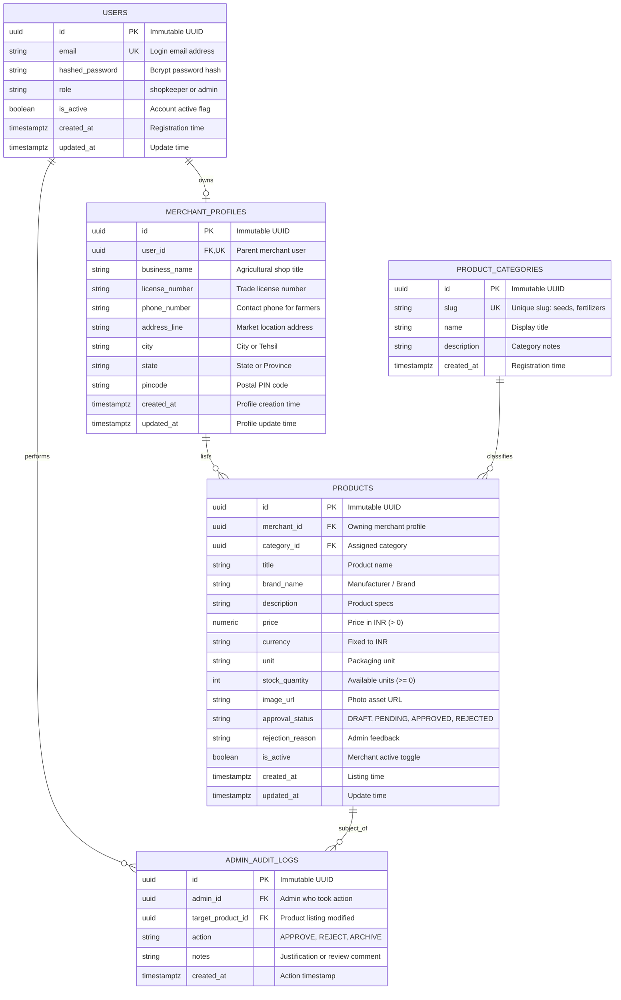
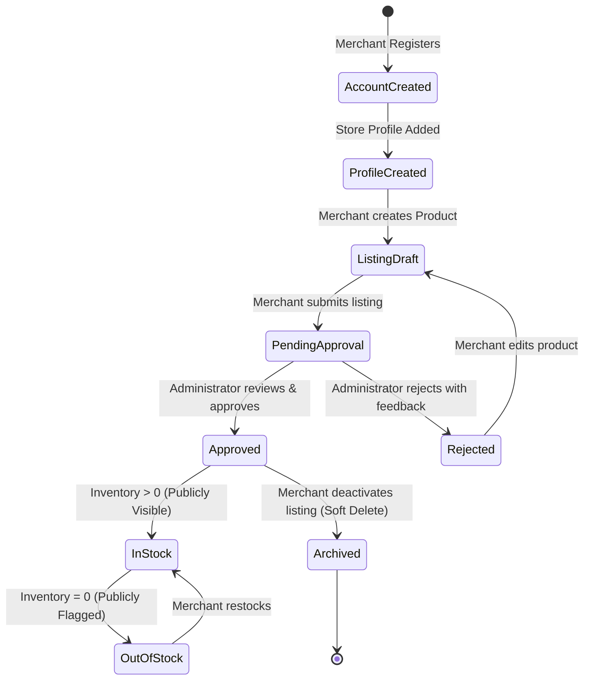

# Database Schema Specification (DATABASE.md)
# AgroGenius AI: Smart Agriculture Platform

**Document Version:** 1.0.0  
**Status:** Approved PostgreSQL Schema Single Source of Truth  
**Target Milestone:** Phase 1 (MVP) through Phase 3 (Marketplace Operations)  
**Author:** Senior Database Architect & Backend Engineer  

---

## 1. Database Overview

### 1.1 Technology Selection & Rationale
- **Database Engine:** PostgreSQL 15+ (Relational Database Management System).
- **Driver & ORM Stack:** `asyncpg` asynchronous driver with SQLAlchemy 2.0 (Declarative Async ORM) and Alembic migration tooling.
- **Rationale:**  
  1. *Relational Integrity & ACID Guarantees:* Essential for multi-tenant merchant identity, inventory tracking, and administrative listing moderation.
  2. *Defensive Constraints:* Strong schema typing, `CHECK` constraints, foreign keys, and unique indexes guarantee data integrity at the storage layer, preventing invalid or negative inventory and unauthorized product states.
  3. *Cloud Readiness:* Supported seamlessly by managed database providers (Render Managed PostgreSQL, Supabase, Neon, AWS RDS).

### 1.2 Database Responsibilities vs. Application Services
PostgreSQL is strictly reserved for stateful entity persistence:
- Authenticated user accounts (merchants and administrators).
- Merchant business profiles and contact information.
- Standardized agricultural product categories.
- Merchant product listings, pricing in Indian Rupees (₹ INR), stock levels, and lifecycle approval states.
- Administrative audit logs for moderation actions.

### 1.3 Transactional Data vs. ML Artifacts & External Data
To avoid architectural anti-patterns, the system enforces a strict boundary between relational records and other application data:
- **ML Datasets & Model Artifacts:** Training data (`Crop_recommendation.csv`) and serialized model weights (`crop_recommendation_model.joblib`) reside strictly in the filesystem / storage volume (`datasets/` and `ml-service/models/`). They are **never** stored as binary blobs (BLOBs) in PostgreSQL.
- **Stateless Farm Intelligence:** Guest farmer crop recommendation requests, agronomic suitability calculations, weather queries, and profit simulations are processed in-memory and are **not** written to PostgreSQL during the guest flow.

---

## 2. Data Storage Boundaries

```
+------------------------------------------------------------------------------------+
|                             DATA STORAGE BOUNDARIES                                |
+-----------------------------+-----------------------+------------------------------+
| Data Category               | Storage Location      | Architectural Justification  |
+-----------------------------+-----------------------+------------------------------+
| Merchant & Admin Accounts   | PostgreSQL (users)    | Relational auth, RBAC, hash. |
+-----------------------------+-----------------------+------------------------------+
| Merchant Store Profiles     | PostgreSQL (profiles) | Business verification & KYC. |
+-----------------------------+-----------------------+------------------------------+
| Product Categories          | PostgreSQL (cat.)     | Seeded controlled taxonomy.  |
+-----------------------------+-----------------------+------------------------------+
| Marketplace Catalog & Stock | PostgreSQL (products) | ACID transactions, queries.  |
+-----------------------------+-----------------------+------------------------------+
| Admin Approval Audit Trail  | PostgreSQL (audits)   | Accountability & timestamps. |
+-----------------------------+-----------------------+------------------------------+
| Crop Recommendation Payload | Ephemeral (RAM only)  | Frictionless guest farmer    |
| (N, P, K, pH, Climate)      |                       | experience (no forced auth). |
+-----------------------------+-----------------------+------------------------------+
| Meteorological Forecasts    | RAM Cache (30m TTL)   | Open-Meteo REST proxy cache; |
|                             |                       | zero database write bloat.   |
+-----------------------------+-----------------------+------------------------------+
| ML Training Datasets &      | File System / Git /   | Serialized Scikit-learn      |
| Model Joblib Artifacts      | Volume Mount          | pipeline files (ml-service). |
+-----------------------------+-----------------------+------------------------------+
| In-App Orders & Payments    | DEFERRED (Post-MVP)   | MVP uses direct contact info |
|                             |                       | (phone/WhatsApp) per PRD.    |
+-----------------------------+-----------------------+------------------------------+
```

---

## 3. Database Tables and Columns

The MVP database schema consists of exactly five normalized, purposeful tables designed to support merchant management, the agricultural marketplace, and administrative moderation.

### 3.1 Table: `users`
- **Purpose:** Stores authenticated user identities for shopkeepers (merchants) and platform administrators.
- **Sensitive Data Handling:** Passwords are never stored in plaintext; application hashes with `bcrypt` before insertion.

| Column Name | PostgreSQL Type | Constraints | Default | Description |
| :--- | :--- | :--- | :--- | :--- |
| `id` | `UUID` | `PRIMARY KEY` | `gen_random_uuid()` | Immutable unique identifier. |
| `email` | `VARCHAR(255)` | `NOT NULL, UNIQUE` | None | Login email (case-insensitive indexed). |
| `hashed_password` | `VARCHAR(255)` | `NOT NULL` | None | Bcrypt password hash string. |
| `role` | `VARCHAR(32)` | `NOT NULL, CHECK (role IN ('shopkeeper', 'admin'))` | `'shopkeeper'` | Role-based authorization token claim. |
| `is_active` | `BOOLEAN` | `NOT NULL` | `TRUE` | Soft-deactivation toggle. |
| `created_at` | `TIMESTAMPTZ` | `NOT NULL` | `NOW()` | Account creation timestamp with UTC zone. |
| `updated_at` | `TIMESTAMPTZ` | `NOT NULL` | `NOW()` | Last account update timestamp. |

### 3.2 Table: `merchant_profiles`
- **Purpose:** Stores physical store, contact, and agricultural licensing details for registered shopkeepers.
- **Ownership:** 1-to-1 relationship with `users`.

| Column Name | PostgreSQL Type | Constraints | Default | Description |
| :--- | :--- | :--- | :--- | :--- |
| `id` | `UUID` | `PRIMARY KEY` | `gen_random_uuid()` | Immutable profile identifier. |
| `user_id` | `UUID` | `NOT NULL, UNIQUE, FOREIGN KEY (users.id) ON DELETE CASCADE` | None | Parent merchant user account. |
| `business_name` | `VARCHAR(255)` | `NOT NULL` | None | Registered agricultural shop name. |
| `license_number` | `VARCHAR(100)` | `NULLABLE` | `NULL` | Commercial seed/fertilizer trade license. |
| `phone_number` | `VARCHAR(20)` | `NOT NULL` | None | Store phone number for farmer inquiries. |
| `address_line` | `TEXT` | `NOT NULL` | None | Street address or village market location. |
| `city` | `VARCHAR(100)` | `NOT NULL` | None | City / Tehsil / Taluk. |
| `state` | `VARCHAR(100)` | `NOT NULL` | None | State / Province. |
| `pincode` | `VARCHAR(10)` | `NOT NULL` | None | Postal PIN code. |
| `created_at` | `TIMESTAMPTZ` | `NOT NULL` | `NOW()` | Profile creation timestamp. |
| `updated_at` | `TIMESTAMPTZ` | `NOT NULL` | `NOW()` | Last profile update timestamp. |

### 3.3 Table: `product_categories`
- **Purpose:** Standardized agricultural input categories. Controlled taxonomy preventing arbitrary categorization.

| Column Name | PostgreSQL Type | Constraints | Default | Description |
| :--- | :--- | :--- | :--- | :--- |
| `id` | `UUID` | `PRIMARY KEY` | `gen_random_uuid()` | Immutable category identifier. |
| `slug` | `VARCHAR(64)` | `NOT NULL, UNIQUE` | None | URL-safe slug (`seeds`, `fertilizers`, etc.). |
| `name` | `VARCHAR(100)` | `NOT NULL` | None | Human-readable category display title. |
| `description` | `TEXT` | `NULLABLE` | `NULL` | Agronomic scope and guidance notes. |
| `created_at` | `TIMESTAMPTZ` | `NOT NULL` | `NOW()` | Category registration timestamp. |

### 3.4 Table: `products`
- **Purpose:** Agricultural products listed by shopkeepers for farmer discovery.
- **Approval Policy Enforcement:** Products are only visible in public marketplace searches if `approval_status = 'APPROVED'` and `is_active = TRUE`.

| Column Name | PostgreSQL Type | Constraints | Default | Description |
| :--- | :--- | :--- | :--- | :--- |
| `id` | `UUID` | `PRIMARY KEY` | `gen_random_uuid()` | Unique product identifier. |
| `merchant_id` | `UUID` | `NOT NULL, FOREIGN KEY (merchant_profiles.id) ON DELETE RESTRICT` | None | Owning merchant profile reference. |
| `category_id` | `UUID` | `NOT NULL, FOREIGN KEY (product_categories.id) ON DELETE RESTRICT` | None | Assigned agricultural category reference. |
| `title` | `VARCHAR(255)` | `NOT NULL` | None | Commercial product title (e.g. "Paddy Seeds"). |
| `brand_name` | `VARCHAR(100)` | `NOT NULL` | None | Manufacturer or brand (e.g. "Mahyco", "IFFCO"). |
| `description` | `TEXT` | `NOT NULL` | None | Specifications, composition, and usage notes. |
| `price` | `NUMERIC(10, 2)`| `NOT NULL, CHECK (price > 0.00)` | None | Unit price in Indian Rupees (₹ INR). |
| `currency` | `VARCHAR(3)` | `NOT NULL, CHECK (currency = 'INR')` | `'INR'` | Standard currency code. |
| `unit` | `VARCHAR(50)` | `NOT NULL` | None | Package packaging unit (e.g. "25kg bag", "1L"). |
| `stock_quantity` | `INTEGER` | `NOT NULL, CHECK (stock_quantity >= 0)` | `0` | Available inventory count. |
| `image_url` | `VARCHAR(1024)` | `NULLABLE` | `NULL` | Static photo asset path or verified URL. |
| `approval_status`| `VARCHAR(32)` | `NOT NULL, CHECK (approval_status IN ('DRAFT', 'PENDING_APPROVAL', 'APPROVED', 'REJECTED', 'ARCHIVED'))` | `'PENDING_APPROVAL'` | Admin moderation status. |
| `rejection_reason`| `TEXT` | `NULLABLE` | `NULL` | Feedback provided if listing is rejected. |
| `is_active` | `BOOLEAN` | `NOT NULL` | `TRUE` | Merchant self-toggle (active / hidden). |
| `created_at` | `TIMESTAMPTZ` | `NOT NULL` | `NOW()` | Creation timestamp. |
| `updated_at` | `TIMESTAMPTZ` | `NOT NULL` | `NOW()` | Last inventory/listing update timestamp. |

### 3.5 Table: `admin_audit_logs`
- **Purpose:** Tracks administrative moderation events on merchant listings to ensure governance and traceability.

| Column Name | PostgreSQL Type | Constraints | Default | Description |
| :--- | :--- | :--- | :--- | :--- |
| `id` | `UUID` | `PRIMARY KEY` | `gen_random_uuid()` | Immutable log identifier. |
| `admin_id` | `UUID` | `NOT NULL, FOREIGN KEY (users.id) ON DELETE RESTRICT` | None | User ID of the reviewing administrator. |
| `target_product_id`| `UUID` | `NOT NULL, FOREIGN KEY (products.id) ON DELETE CASCADE` | None | The product listing that was acted upon. |
| `action` | `VARCHAR(32)` | `NOT NULL, CHECK (action IN ('APPROVE_PRODUCT', 'REJECT_PRODUCT', 'ARCHIVE_PRODUCT'))` | None | Administrative action performed. |
| `notes` | `TEXT` | `NULLABLE` | `NULL` | Reviewer notes or rejection justification. |
| `created_at` | `TIMESTAMPTZ` | `NOT NULL` | `NOW()` | Timestamp when the action was taken. |

---

## 4. Relationships and ER Diagram

The entity-relationship model enforces clean normalization, zero redundancy, and strict referential integrity.



---

## 5. Data Integrity and Validation

To guarantee rock-solid application stability, integrity checks are enforced defensively across both PostgreSQL (storage engine) and FastAPI (application engine).

### 5.1 Storage-Level Constraints (PostgreSQL)
1. **Positive Pricing Rule:**  
   `CONSTRAINT check_product_price_positive CHECK (price > 0.00)`  
   Zero or negative product prices are physically rejected by the database.
2. **Non-Negative Inventory Rule:**  
   `CONSTRAINT check_product_stock_non_negative CHECK (stock_quantity >= 0)`  
   Stock counts can reach zero ("Out of Stock"), but can never underflow into negative numbers.
3. **Mandatory Currency Enforcement:**  
   `CONSTRAINT check_currency_inr CHECK (currency = 'INR')`  
   Guarantees that all financial valuations conform to the approved Indian Rupee specification.
4. **Approval State Validation:**  
   `CONSTRAINT check_approval_status CHECK (approval_status IN ('DRAFT', 'PENDING_APPROVAL', 'APPROVED', 'REJECTED', 'ARCHIVED'))`  
   Prevents unhandled or typo-ridden approval states.
5. **Role Validation:**  
   `CONSTRAINT check_user_role CHECK (role IN ('shopkeeper', 'admin'))`  
   Restricts account access to valid system personas.

### 5.2 Application-Level Validation (FastAPI Pydantic v2)
While PostgreSQL acts as the ultimate barrier, FastAPI validates inputs *before* database execution:
- Sanitizes string inputs to prevent whitespace bloat and XSS payloads.
- Validates phone number formats (standard 10-digit Indian mobile formats: `^[6-9]\d{9}$`).
- Validates postal PIN codes (standard 6-digit Indian PIN: `^[1-9][0-9]{5}$`).
- Validates email formats using `EmailStr`.

---

## 6. Authentication and Authorization Support

### 6.1 Merchant Identity and Security
- Password credentials submitted to `/api/v1/merchant/login` are verified against `users.hashed_password` using `passlib[bcrypt]`.
- Upon verification, FastAPI issues a cryptographically signed JSON Web Token (JWT) containing `sub: user.id` and `role: user.role`.
- Sessions are stateless; raw tokens are never written to PostgreSQL.

### 6.2 Product Ownership Verification
To protect merchants against cross-tenant tampering:
- In all product modification endpoints (`PUT /api/v1/merchant/products/{id}`, `DELETE /api/v1/merchant/products/{id}`), the query joins `products` with `merchant_profiles` and strictly asserts:
  `WHERE products.id = :product_id AND merchant_profiles.user_id = :current_user_id`
- Any attempt by a merchant to alter another merchant's product aborts with HTTP `403 Forbidden`.

### 6.3 Administrative Listing Moderation
- Only JWT tokens bearing `role: 'admin'` are permitted to execute status transitions on `/api/v1/admin/products/{id}/approve` and `/api/v1/admin/products/{id}/reject`.
- Transitions insert an immutable record into `admin_audit_logs` in the same database transaction.

---

## 7. Indexing Strategy

Indexes are defined strictly to accelerate actual query paths executed by the frontend and backend, avoiding redundant storage overhead.

```sql
-- 1. Accelerates merchant/admin login lookup by email (case-insensitive)
CREATE UNIQUE INDEX idx_users_email_lower ON users (LOWER(email));

-- 2. Enforces 1-to-1 merchant user lookup and accelerates profile fetch
CREATE UNIQUE INDEX idx_merchant_profiles_user_id ON merchant_profiles (user_id);

-- 3. Composite index for the public marketplace catalog query:
-- Query: SELECT * FROM products WHERE approval_status = 'APPROVED' AND is_active = TRUE AND category_id = :cat ORDER BY created_at DESC
CREATE INDEX idx_products_public_catalog 
ON products (category_id, created_at DESC) 
WHERE approval_status = 'APPROVED' AND is_active = TRUE;

-- 4. Accelerates merchant dashboard catalog listing:
-- Query: SELECT * FROM products WHERE merchant_id = :id ORDER BY updated_at DESC
CREATE INDEX idx_products_merchant_dashboard 
ON products (merchant_id, updated_at DESC);

-- 5. Accelerates admin moderation queue:
-- Query: SELECT * FROM products WHERE approval_status = 'PENDING_APPROVAL' ORDER BY created_at ASC
CREATE INDEX idx_products_admin_pending 
ON products (created_at ASC) 
WHERE approval_status = 'PENDING_APPROVAL';

-- 6. Trigram index for keyword search on product titles and brand names
CREATE INDEX idx_products_title_trgm ON products USING gin (title gin_trgm_ops);
```

---

## 8. Migration Strategy

### 8.1 Migration Framework: Alembic
- Database schema versioning will be managed using **Alembic** within the `backend/` module.
- Migrations will be tracked under `backend/alembic/versions/` and version-controlled in Git.

### 8.2 Migration Lifecycle Rules
1. **Never Modify Existing Applied Migrations:** Schema changes must always take the form of forward-only new migration scripts (`alembic revision --autogenerate -m "description"`).
2. **Reversible Schema Operations:** Every migration must provide both `upgrade()` and `downgrade()` methods.
3. **Automated CI/CD Execution:** In production deployments (e.g. Render build lifecycle), migrations execute prior to launching Uvicorn:
   `alembic upgrade head && uvicorn app.main:app --host 0.0.0.0 --port $PORT`
4. **Zero Downtime Additions:** Columns added to existing tables must be created as `NULLABLE` or define a safe server default.

---

## 9. Development and Seed Data

### 9.1 Seed Data Scope
To enable immediate frontend and backend testing without fabricating real marketplace inventory:
- **Default System Admin:** Pre-seeded local administrator account (`admin@agrogenius.ai`) with encrypted password hash.
- **Controlled Product Categories:** Seeded categories with permanent slugs:
  1. `seeds` — Certified High-Yield Seeds & Seedlings
  2. `fertilizers` — NPK Fertilizers & Soil Micro-nutrients
  3. `crop_protection` — Bio-pesticides, Herbicides & Plant Protection
  4. `machinery_tools` — Spraying Equipment & Agricultural Tools
- **Demonstration Merchants & Products:** Clearly marked sample listings with `brand_name = 'Demo Agronomics'` and dummy phone numbers to prevent real-world confusion.

### 9.2 Idempotent Seeding Script
A dedicated Python seeding script (`backend/scripts/seed.py`) uses `ON CONFLICT DO NOTHING` clauses based on unique keys (`email`, `slug`), ensuring safe re-execution without creating duplicate records.

---

## 10. Sensitive Data and Privacy

1. **Credential Segregation:**
   - Plaintext passwords never touch logs, database columns, or error payloads.
   - Database connection credentials use environment variables (`DATABASE_URL`) loaded through `backend/app/core/config.py`.
2. **Minimal Farmer Footprint:**
   - In strict alignment with PRD.md, **no personal identifying information (PII)** is captured from farmers using the crop recommendation, advisory, or weather features.
3. **Transport Security:**
   - Production connections require TLS/SSL encryption (`sslmode=require`), preventing packet inspection across cloud providers.

---

## 11. Transactions and Concurrency

### 11.1 Transaction Isolation
PostgreSQL operates under the standard `READ COMMITTED` isolation level, which is optimal for web workloads.

### 11.2 Atomic Operations
- **Product Creation & Stock Adjustment:** Handled within explicit atomic sessions:
  ```python
  async with session.begin():
      # Creates product and generates audit log entry atomically
      session.add(new_product)
  ```
- **Administrative Moderation:** When an admin approves or rejects a listing, updating `products.approval_status` and inserting into `admin_audit_logs` occurs within a single transaction. If the audit log insert fails, the status update rolls back automatically.

---

## 12. Backup and Recovery

### 12.1 Automated Managed Backups
- For staging and production on Render / Supabase Managed PostgreSQL:
  - Automated continuous Write-Ahead Log (WAL) archiving with point-in-time recovery (PITR) up to 7 days.
  - Daily full database logical dumps (`pg_dump`) archived securely.

### 12.2 Development Database Reset
Developers can safely tear down and rebuild their local PostgreSQL database using the standard Alembic downgrade/upgrade sequence:
```bash
alembic downgrade base
alembic upgrade head
python scripts/seed.py
```

---

## 13. Data Lifecycle



1. **Account Creation:** Merchant account registered in `users` with `role = 'shopkeeper'`.
2. **Profile Completion:** Store address, phone, and license details recorded in `merchant_profiles`.
3. **Listing Creation:** Merchant creates product with default `approval_status = 'PENDING_APPROVAL'`.
4. **Admin Moderation:** Admin reviews listing via `/api/v1/admin/products/*`. Upon approval, listing becomes visible in the public marketplace.
5. **Inventory Depletion:** If `stock_quantity` reaches `0`, product remains visible with an "Out of Stock" badge.
6. **Soft Deletion / Archival:** Setting `is_active = FALSE` or `approval_status = 'ARCHIVED'` immediately hides the product from the public catalog without breaking referential integrity in past audit logs.

---

## 14. Open Decisions, Risks, and Deferred Features

### 14.1 Explicitly Deferred Tables (Post-MVP)
To prevent premature complexity and maintain focus on the core ML recommendation milestone:
1. **`orders` and `order_items` Tables:** PRD.md explicitly excludes digital checkout and escrow for MVP. Communication is facilitated directly via merchant contact channels.
2. **`recommendation_history` Table:** Anonymous guest farmers are not tracked in the database. A saved plans table will be introduced only when authenticated farmer accounts are released in future phases.
3. **`weather_cache` Table:** Dynamic caching is handled efficiently in FastAPI backend memory (30-min TTL), eliminating unnecessary database write I/O.

### 14.2 Risks and Mitigations
- **Risk:** High concurrency during product approval causing race conditions.  
  *Mitigation:* Single atomic database transaction encapsulating status change and audit log creation.
- **Risk:** Malicious shopkeepers injecting spam products.  
  *Mitigation:* Strict admin approval gate enforced at database query level (`WHERE approval_status = 'APPROVED'`).

### 14.3 Decisions Requiring Future Alignment
1. **Merchant License Verification:** Should the `license_number` column be strictly mandatory before product submission, or optional for small nursery artisans? (Current schema allows `NULLABLE` to avoid blocking local artisans).

---
*End of Database Schema Specification (DATABASE.md)*
