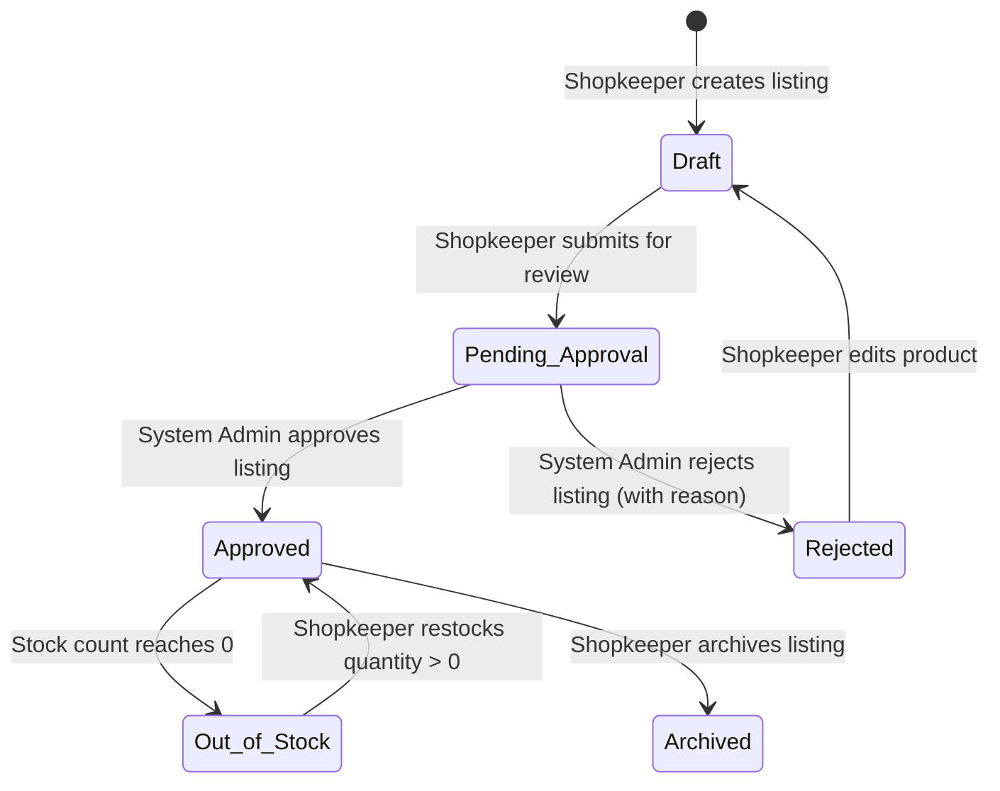

# Design System & UX Specification (DESIGN.md)
# AgroGenius AI: Smart Agriculture Platform

**Document Version:** 1.0.0  
**Status:** Approved Single Source of Truth for Visual Design & UX  
**Project:** AgroGenius AI  
**Author:** Senior Product Designer & UX/UI Design Systems Architect  

---

## 1. Design Vision and Principles

AgroGenius AI is designed as a serious, professional agricultural operating tool for farmers, agricultural extension workers, and verified merchants. It is specifically built **not** to look like a generic tech SaaS landing page, a crypto project, or an AI concept demo with superficial neon glow effects and floating decorative cards.

### 1.1 Core Design Principles

1. **Agronomic Grounding over Visual Novelty:**  
   Every UI component, metric card, and visualization must reflect physical agricultural reality. Soil chemistry, weather patterns, and economics are communicated with clarity, using standard agronomic units ($kg/ha$, $pH$, $^\circ\text{C}$, $\%$, $mm$, $₹$, and $\text{Acres}$).
2. **Transparent AI & Zero Fabrication:**  
   Model outputs are explicitly presented as probabilistic guidance with visible confidence scores, feature suitability breakdowns, and limitations. The interface never guarantees harvest success, never presents fake weather, and never displays unverified market prices or unapproved merchant products.
3. **Frictionless Utility for Rural & Mobile Users:**  
   The primary crop recommendation and advisory engines require zero authentication. The design prioritizes mobile viewports ($360\text{px} - 430\text{px}$), outdoor sunlight legibility (high contrast), touch-friendly input targets ($\ge 48\text{px}$), and offline-resilient input preservation.
4. **Structured Density & Visual Hierarchy:**  
   Information is chunked into logical fieldsets, clear step flows, and card containers. Complex scientific data is made digestible through comparative progress indicators, status badges, and contextual tooltips without overwhelming the user.
5. **Calm, Earth-Rooted Aesthetic:**  
   The aesthetic balances deep forest greens, warm organic neutral surfaces, and disciplined lime-green accents that draw focus strictly to primary calls to action, status alerts, and confirmation states.

---

## 2. Visual Identity & Agricultural Technology Theme

The visual identity embodies the intersection of modern agronomic science and computational intelligence:
- **Atmosphere:** Deep forest greens evocative of healthy canopy growth, paired with warm off-white and fertile soil undertones.
- **Surface Elevation:** Subtle, layered tonal elevations rather than harsh box shadows or hyper-translucent glassmorphism.
- **Accents:** High-visibility lime and emerald tones used strictly for active states, high-confidence recommendation badges, and progress indicators.
- **Imagery:** Authentic agricultural photography of real crops, leaves, soil profiles, and local mandi marketplaces. Rendered illustrations or abstract AI blobs are strictly forbidden.

---

## 3. Color Palette with Semantic Color Tokens

The color system is structured using CSS Custom Properties. It provides complete token mappings for both Default Light (Field Daylight Mode) and Deep Green Dark Mode (low-glare field use).

### 3.1 Primitive Color Tokens

```css
:root {
  /* Brand Greens */
  --color-green-950: #06180c; /* Deepest Forest Base */
  --color-green-900: #0b2416; /* Primary Dark Background */
  --color-green-850: #0f301e; /* Elevated Card Surface Dark */
  --color-green-800: #143e27; /* Container Border Dark */
  --color-green-700: #1c5234; /* Subtle Accent Dark */
  --color-green-600: #246a43; /* Medium Leaf Green */
  --color-green-500: #2f855a; /* Classic Agricultural Green */
  --color-green-400: #10b981; /* Fresh Emerald */
  --color-green-300: #22c55e; /* Vibrant Lime Green (Primary Accent) */
  --color-green-200: #86efac; /* Pale Foliage Mint */
  --color-green-100: #dcfce7; /* Light Green Tint */
  --color-green-50:  #f0fdf4; /* Ultra-light Surface Tint */

  /* Warm Neutrals (Soil & Grain Inspired) */
  --color-warm-900:  #1c1917; /* Warm Deep Charcoal */
  --color-warm-800:  #292524; /* Warm Dark Border */
  --color-warm-700:  #44403c; /* Dark Neutral Text */
  --color-warm-600:  #57534e; /* Muted Secondary Text */
  --color-warm-500:  #78716c; /* Tertiary Placeholder Text */
  --color-warm-400:  #a8a29e; /* Outline / Disabled Border */
  --color-warm-300:  #d6d3d1; /* Field Container Border */
  --color-warm-200:  #e7e5e4; /* Card Divider */
  --color-warm-100:  #f5f5f4; /* Off-White Warm Neutral Canvas */
  --color-warm-50:   #fafaf9; /* Crisp Warm Canvas */
  --color-white:     #ffffff;

  /* Semantic State Colors */
  --color-success-bg:     #052e16;
  --color-success-border: #166534;
  --color-success-text:   #4ade80;

  --color-warning-bg:     #2e1b04;
  --color-warning-border: #854d0e;
  --color-warning-text:   #fbbf24;

  --color-error-bg:       #310d0d;
  --color-error-border:   #991b1b;
  --color-error-text:     #f87171;

  --color-info-bg:        #082436;
  --color-info-border:    #075985;
  --color-info-text:      #38bdf8;
}
```

### 3.2 Semantic Theme Tokens (Dark Mode Default for AgroGenius AI)

To ensure field durability and reduced eye fatigue under varying daylight conditions, AgroGenius AI operates on a refined dark-green foundation with high-contrast warm text:

| Token Name | Value | Purpose |
| :--- | :--- | :--- |
| `--bg-app` | `#081a10` | Global application canvas background |
| `--bg-surface` | `#0f291b` | Primary card and container background |
| `--bg-surface-elevated`| `#153625` | Elevated modals, dropdowns, and flyouts |
| `--bg-surface-subtle` | `#0a2115` | Input field background, nested table headers |
| `--border-subtle` | `#1a432e` | Default container and card dividers |
| `--border-strong` | `#286044` | Active input borders, table borders |
| `--border-accent` | `#22c55e` | Focus rings, selected state borders |
| `--text-primary` | `#f2f7f3` | High-contrast body text and headings ($14.2:1$ contrast) |
| `--text-secondary` | `#a4c2b0` | Helper text, secondary descriptors ($6.8:1$ contrast) |
| `--text-tertiary` | `#6a8e78` | Unit labels ($kg/ha$), inactive states, placeholders |
| `--accent-primary` | `#22c55e` | Primary action buttons, success badges, key values |
| `--accent-hover` | `#16a34a` | Hover state for primary buttons |
| `--accent-subtle` | `rgba(34, 197, 94, 0.12)` | Badge backgrounds, active nav pill backgrounds |

---

## 4. Typography System

The typography system relies on robust, highly legible system fonts that load instantaneously without requiring external network fonts, ensuring immediate usability on low-bandwidth rural connections.

### 4.1 Font Families
- **Primary Body & Display:** `Inter, -apple-system, BlinkMacSystemFont, "Segoe UI", Roboto, sans-serif`
- **Tabular Data & Numbers:** `ui-monospace, "SF Mono", Menlo, Consolas, "Liberation Mono", monospace` (Used for NPK values, probabilities, currency, and coordinates).

### 4.2 Type Scale & Hierarchy

| Role | Size ($px$) | Line Height | Weight | Letter Spacing | Use Case |
| :--- | :--- | :--- | :--- | :--- | :--- |
| **Display 1** | $40\text{px}$ ($2.5\text{rem}$) | $115\%$ | 700 (Bold) | $-0.02\text{em}$ | Hero headlines, primary platform statement |
| **Heading 1** | $32\text{px}$ ($2.0\text{rem}$) | $120\%$ | 700 (Bold) | $-0.015\text{em}$ | Section titles (Recommendation Studio, Marketplace) |
| **Heading 2** | $24\text{px}$ ($1.5\text{rem}$) | $125\%$ | 600 (Semibold) | $-0.01\text{em}$ | Card titles, major modular blocks |
| **Heading 3** | $18\text{px}$ ($1.125\text{rem}$) | $130\%$ | 600 (Semibold) | $0.0\text{em}$ | Card subheads, table group headings |
| **Body Large** | $16\text{px}$ ($1.0\text{rem}$) | $150\%$ | 400 (Regular) / 500 (Medium) | $0.0\text{em}$ | Introductory paragraphs, highlighted advisory text |
| **Body Default**| $14\text{px}$ ($0.875\text{rem}$)| $145\%$ | 400 (Regular) | $0.0\text{em}$ | Standard UI text, descriptions, table rows |
| **Caption / Unit**| $12\text{px}$ ($0.75\text{rem}$)| $140\%$ | 500 (Medium) | $+0.02\text{em}$ | Measurement units ($kg/ha$, $pH$, $mm$), timestamps |
| **Numeric Data**| $15\text{px}$ ($0.9375\text{rem}$)| $120\%$ | 600 (Semibold) | $+0.01\text{em}$ | Soil test numbers, prices, confidence percentages |

---

## 5. Spacing, Sizing, and Layout Conventions

The spacing and layout system follows a strict **8-point spatial grid** (with a 4-point micro-step for compact controls):

```css
:root {
  --space-1:  4px;
  --space-2:  8px;
  --space-3: 12px;
  --space-4: 16px;
  --space-5: 20px;
  --space-6: 24px;
  --space-8: 32px;
  --space-10: 40px;
  --space-12: 48px;
  --space-16: 64px;
  --space-20: 80px;

  /* Border Radii */
  --radius-sm:  4px;  /* Tooltips, micro badges */
  --radius-md:  8px;  /* Buttons, inputs, pills */
  --radius-lg: 12px;  /* Cards, modals, containers */
  --radius-xl: 16px;  /* Primary studio frames */
  --radius-full: 9999px; /* Status tags, rounded pills */

  /* Elevation Shadows */
  --shadow-sm: 0 1px 2px rgba(0, 0, 0, 0.35);
  --shadow-md: 0 4px 6px -1px rgba(0, 0, 0, 0.45), 0 2px 4px -2px rgba(0, 0, 0, 0.35);
  --shadow-lg: 0 10px 15px -3px rgba(0, 0, 0, 0.55), 0 4px 6px -4px rgba(0, 0, 0, 0.4);
  --shadow-card: 0 0 0 1px var(--border-subtle), var(--shadow-sm);
  --shadow-card-hover: 0 0 0 1px var(--border-strong), var(--shadow-md);
}
```

---

## 6. Responsive Breakpoints and Behavior

| Breakpoint Name | Width Threshold | Layout Structure | Navigation Pattern |
| :--- | :--- | :--- | :--- |
| **Mobile (`sm`)** | $320\text{px} - 639\text{px}$ | 1-Column full width; $16\text{px}$ gutter; sticky bottom action bars. | Bottom navigation bar / Hamburger sheet. |
| **Tablet (`md`)** | $640\text{px} - 1023\text{px}$| 2-Column fluid grid; $24\text{px}$ gutter; collapsible filter drawer. | Top bar with condensed icon labels. |
| **Desktop (`lg`)** | $1024\text{px} - 1279\text{px}$| Multi-column dashboard grid; $32\text{px}$ gutter; max content width $1200\text{px}$. | Fixed top header with active route indicator. |
| **Wide Desktop (`xl`)**| $\ge 1280\text{px}$ | 12-Column grid system; max container width $1280\text{px}$; side-by-side inputs and results. | Full top header with secondary portal actions. |

---

## 7. Navigation Structure

```
+---------------------------------------------------------------------------------------------------------+
| [AGROGENIUS AI LOGO]   Recommend   Advisory   Weather   Economics   Marketplace  | [Merchant Portal CTA] |
+---------------------------------------------------------------------------------------------------------+
```

### 7.1 Desktop Header Specifications
- **Height:** $68\text{px}$, fixed at top with subtle backdrop blur (`backdrop-filter: blur(8px)`, background `rgba(8, 26, 16, 0.92)`).
- **Branding:** Left-aligned AgroGenius AI wordmark paired with a geometric leaf/sensor glyph.
- **Center Navigation:** Horizontal list of primary links. Active link is decorated with an emerald underline (`2px solid var(--accent-primary)`) and `--text-primary` color.
- **Right Action Area:** Location pill showing current detected weather city (e.g. `📍 Nashik, 28°C`) and "Merchant Portal" outline button.

### 7.2 Mobile Navigation Specifications
- **Top Mobile Header:** $56\text{px}$ high. Displays Logo on left, location badge in center, and Hamburger trigger on right.
- **Bottom Tab Bar (Quick Access):** $60\text{px}$ fixed bar with 4 primary icons:
  1. `Recommend` (Leaf icon)
  2. `Weather` (Cloud-sun icon)
  3. `Economics` (Calculator/Rupee icon)
  4. `Market` (Storefront icon)

---

## 8. Page-Level Layout Specifications

```
+-----------------------------------------------------------------------------+
| GLOBAL TOP HEADER (Height: 68px, Sticky)                                   |
+-----------------------------------------------------------------------------+
| BREADCRUMBS & CONTEXT BAR (Height: 40px, Optional)                         |
+-----------------------------------------------------------------------------+
| MAIN CONTENT AREA (Max Width: 1240px, Centered, Padding: 24px)              |
|                                                                             |
| +------------------------------------+ +----------------------------------+ |
| | PRIMARY INTERACTION PANEL          | | SECONDARY RESULTS / CONTEXT      | |
| | (e.g. Soil & Climate Input Form)   | | (e.g. Ranked Output, Forecast)   | |
| | Width: 45% (Desktop)               | | Width: 55% (Desktop)             | |
| +------------------------------------+ +----------------------------------+ |
|                                                                             |
+-----------------------------------------------------------------------------+
| GLOBAL FOOTER (Disclaimers, Citations, System Status)                       |
+-----------------------------------------------------------------------------+
```

---

## 9. Reusable UI Components

### 9.1 Buttons
- **Primary Action Button:**
  - Background: `var(--accent-primary)` (`#22c55e`), Text: `#06180c` (Bold 600).
  - Hover: Background `#16a34a`, Transform `translateY(-1px)`, Box-shadow: `0 4px 12px rgba(34, 197, 94, 0.25)`.
  - Active: Transform `translateY(0)`.
  - Focus-visible: Outline `2px solid #22c55e`, outline-offset `2px`.
  - Disabled: Background `var(--border-subtle)`, Text `var(--text-tertiary)`, cursor `not-allowed`.
- **Secondary / Outline Button:**
  - Background: `transparent`, Border: `1px solid var(--border-strong)`, Text: `var(--text-primary)`.
  - Hover: Border `1px solid var(--accent-primary)`, Background `var(--accent-subtle)`.
- **Ghost Button:**
  - Background: `transparent`, Text: `var(--text-secondary)`. Hover: Text `var(--text-primary)`.

### 9.2 Cards
- **Standard Card Container:**
  - Background: `var(--bg-surface)` (`#0f291b`).
  - Border: `1px solid var(--border-subtle)` (`#1a432e`).
  - Border-radius: `var(--radius-lg)` (`12px`).
  - Padding: `var(--space-6)` ($24\text{px}$) on desktop; `var(--space-4)` ($16\text{px}$) on mobile.
- **Interactive Card (Marketplace / Alternatives):**
  - Hover transition: `border-color 0.2s ease, transform 0.2s ease`.
  - Hover effect: Border changes to `var(--border-strong)`, `translateY(-2px)`.

### 9.3 Badges and Status Tags
- **Confidence Badge:** Pill-shaped (`border-radius: 9999px`), padding `4px 10px`, font size `12px`, weight 600.
  - High ($\ge 90\%$): Background `rgba(34, 197, 94, 0.15)`, Border `1px solid #22c55e`, Text `#4ade80`.
  - Medium ($70\% - 89\%$): Background `rgba(251, 191, 36, 0.15)`, Border `1px solid #d97706`, Text `#fbbf24`.
  - Low ($< 70\%$): Background `rgba(248, 113, 113, 0.15)`, Border `1px solid #dc2626`, Text `#f87171`.
- **Stock Status Badge:**
  - "In Stock": Text `#4ade80`, dot indicator `6px` green.
  - "Out of Stock": Text `#f87171`, dot indicator `6px` red.
- **Merchant Listing Approval Badge:**
  - "Approved & Active": Green outline pill.
  - "Pending Admin Approval": Amber pill (`#fbbf24`), hourglass glyph.
  - "Rejected / Action Required": Red pill (`#f87171`), warning icon.

---

## 10. Form Design and Validation Feedback

### 10.1 Input Fields
- **Container Structure:**
  1. Label with unit badge (e.g. `Nitrogen (N)` + `kg/ha`).
  2. Input container with numeric entry, step buttons, and clear icon.
  3. Contextual range hint (e.g. `Normal agricultural range: 0 – 140 kg/ha`).
- **Styling Tokens:**
  - Height: $44\text{px}$ (Desktop), $48\text{px}$ (Mobile).
  - Background: `var(--bg-surface-subtle)` (`#0a2115`).
  - Border: `1px solid var(--border-subtle)` (`#1a432e`).
  - Text: `var(--text-primary)`, Font family: monospace numbers.
  - Focus state: Border `1px solid var(--accent-primary)`, Box-shadow: `0 0 0 3px rgba(34, 197, 94, 0.2)`.
  - Error state: Border `1px solid var(--color-error-text)`, Box-shadow: `0 0 0 3px rgba(248, 113, 113, 0.2)`.

### 10.2 Validation Messaging Rules
- Validation is triggered `onBlur` for initial entry and `onChange` once in an error state.
- Error messages appear directly below the field in `12px` font with a red warning glyph:
  - Example: `⚠️ Nitrogen must be between 0 and 140 kg/ha.`
- The form submit button is disabled until all required fields pass boundary checks, preventing unnecessary API roundtrips.

---

## 11. Crop Recommendation Input Experience

```
+------------------------------------------------------------------------------------+
|  CROP RECOMMENDATION STUDIO                                                       |
|  Enter your soil test results and environmental data to receive ML guidance.      |
+------------------------------------------------------------------------------------+
|  STEP 1: SOIL CHEMICAL PROPERTIES                                                  |
|                                                                                    |
|  [ Nitrogen (N) kg/ha ] [ Phosphorus (P) kg/ha ] [ Potassium (K) kg/ha ] [ Soil pH ]|
|  [ 40                ] [ 50                   ] [ 80                 ] [ 6.5     ] |
|  Range: 0 - 140        Range: 5 - 145           Range: 5 - 205         Range: 3.5-9|
|                                                                                    |
|  STEP 2: ENVIRONMENTAL & WEATHER METRICS                                          |
|  [ ⛅ Auto-Detect from Location (Open-Meteo) ]   [ ✏️ Enter Manually ]            |
|                                                                                    |
|  [ Temperature (°C) ]   [ Relative Humidity (%) ]    [ Rainfall (mm) ]            |
|  [ 25.4             ]   [ 78.2                  ]    [ 182.5         ]            |
|                                                                                    |
|  [ RUN AI RECOMMENDATION (Instant) ]             [ Reset Form ]                    |
+------------------------------------------------------------------------------------+
```

### 11.1 Quick Presets Bar
To allow extension workers or curious farmers to explore without a physical soil report, provide 3 realistic agronomic presets:
1. `Alluvial Rice Belt` ($N=80, P=40, K=40, pH=6.5, \text{Temp}=27^\circ\text{C}, \text{Rain}=200\text{mm}$)
2. `Black Soil Cotton Basin` ($N=60, P=50, K=50, pH=7.8, \text{Temp}=29^\circ\text{C}, \text{Rain}=90\text{mm}$)
3. `Arid Pulse Field` ($N=20, P=60, K=40, pH=7.2, \text{Temp}=24^\circ\text{C}, \text{Rain}=45\text{mm}$)

---

## 12. Crop Recommendation Results and Alternatives

```
+------------------------------------------------------------------------------------+
|  RECOMMENDED PRIMARY CROP                                                          |
|  +-------------------------------------------------------------------------------+ |
|  | [REAL CROP PHOTO]  RICE (Oryza sativa)                       [94.2% MATCH]    | |
|  |                    Kharif Season • High Water Requirement                     | |
|  |                                                                               | |
|  | "Your soil's high nitrogen retention and rainfall profile (182mm) provide an  | |
|  | ideal environment for wetland rice cultivation."                             | |
|  |                                                                               | |
|  | [ View Seed & Fertilizer Plan ]       [ Calculate Cultivation Costs & Profit ]| |
|  +-------------------------------------------------------------------------------+ |
|                                                                                    |
|  VIABLE ALTERNATIVE CROPS                                                          |
|  +-------------------------------------+   +-------------------------------------+ |
|  | JUTE (Corchorus)        [82.1% MATCH] |   | MAIZE (Zea mays)        [68.4% MATCH] | |
|  | High humidity match; lower fertilizer|   | Well-suited if irrigation is reduced| |
|  | [Explore Jute Plan]                 |   | [Explore Maize Plan]                | |
|  +-------------------------------------+   +-------------------------------------+ |
|                                                                                    |
|  ⚠️ MODEL LIMITATION DISCLAIMER                                                    |
|  Predictions are probabilistic AI recommendations based on empirical soil dataset  |
|  features. They do not constitute a harvest guarantee or crop insurance policy.   |
+------------------------------------------------------------------------------------+
```

### 12.1 Visual Hierarchy of Results
1. **Primary Recommendation Banner:** Displays an authentic crop photograph (left $120\times 120\text{px}$ thumbnail), crop common and botanical names, high-contrast confidence pill, and a 2-sentence agronomic synthesis.
2. **Alternative Cards:** Two compact secondary cards displaying rank #2 and rank #3 predicted crops with confidence badges and comparative differentiators (e.g. "Requires $30\%$ less water").
3. **Persistent Agronomic Disclaimer:** A dark amber banner (`var(--color-warning-bg)`) at the base of the recommendation card.

---

## 13. Crop Suitability Explanation Presentation

To ensure complete transparency and prevent "black-box" AI skepticism, the suitability breakdown displays the user's input parameter vs. the crop's ideal biological range:

```
+-----------------------------------------------------------------------------+
| CROP SUITABILITY FACTOR BREAKDOWN: RICE                                     |
+-----------------------------------------------------------------------------+
| Parameter    User Value     Optimal Range     Status        Visual Indicator|
+-----------------------------------------------------------------------------+
| Nitrogen (N) 80 kg/ha       60 - 100 kg/ha    Optimal       [====*====]     |
| Phosphorus(P)40 kg/ha       35 - 60 kg/ha     Optimal       [===*=====]     |
| Potassium (K)40 kg/ha       35 - 50 kg/ha     Optimal       [====*====]     |
| Soil pH      6.5            5.5 - 7.2         Optimal       [=====*===]     |
| Temperature  26.5 °C        22 - 32 °C        Optimal       [====*====]     |
| Humidity     82 %           70 - 90 %         Optimal       [=====*===]     |
| Rainfall     182 mm         150 - 250 mm      Adequate      [===*=====]     |
+-----------------------------------------------------------------------------+
```
- **Visual Gauge:** A segmented range bar where the green zone represents the crop's sweet spot, and an emerald marker (`*`) pinpoints the user's soil condition.
- **Deficiency / Excess Alerts:** If a parameter is deficient (e.g. $N=20$ when $80$ is required), the bar turns amber with an explicit remediation badge: `Deficient (-60 kg/ha needed)`.

---

## 14. Seed and Fertilizer Guidance Layouts

### 14.1 Seed Guidance Layout
- **Cultivar Grid:** Displays 2 to 3 standard government-certified or high-performing commercial seed varieties.
- **Agronomic Parameters Table:**
  - Sowing Method: (e.g. *Transplanting / Direct Seeding*)
  - Seed Rate: *20 – 25 kg/acre*
  - Sowing Depth: *2 – 3 cm*
  - Germination Temp: *20°C – 35°C*
- **Source Citation:** `Source: ICAR - Indian Institute of Rice Research (IIRR) Agronomy Bulletin.`

### 14.2 Fertilizer Guidance Layout
- **Nutrient Status Cards:** 3 cards for $N$, $P$, and $K$ showing Soil Level vs. Recommended Level.
- **Application Schedule Timeline:**
  - **Basal Application (At Sowing):** $50\%$ Nitrogen, $100\%$ Phosphorus, $100\%$ Potassium.
  - **First Top-Dressing (Tillering Stage, Day 21-25):** $25\%$ Nitrogen.
  - **Second Top-Dressing (Panicle Initiation, Day 45-50):** $25\%$ Nitrogen.
- **Organic Recommendation:** Recommended farmyard manure (FYM) or compost dosage per acre.
- **Extension Warning:** `⚠️ Dosage should be calibrated based on localized official soil test cards.`

---

## 15. Weather Information Presentation

```
+-----------------------------------------------------------------------------+
| WEATHER INTELLIGENCE: NASHIK, MAHARASHTRA                                   |
| Source: Open-Meteo Meteorological Service (Updated 12 mins ago)             |
+-----------------------------------------------------------------------------+
| CURRENT CONDITIONS                                                          |
| [☀️ 28.4°C]   Humidity: 64%   Wind: 14 km/h   Precipitation: 0.0 mm         |
+-----------------------------------------------------------------------------+
| FARMING ALERT:                                                              |
| 🟢 Favorable Spraying Conditions: Low wind velocity and no rain expected.    |
+-----------------------------------------------------------------------------+
| 5-DAY AGRICULTURAL FORECAST                                                 |
| Today      Tomorrow      Thu           Fri           Sat                    |
| [☀️ 28°/18°] [⛅ 29°/19°]  [🌧️ 25°/17°]  [🌧️ 24°/16°]  [⛅ 27°/18°]           |
| Rain: 0mm   Rain: 0mm     Rain: 18mm    Rain: 32mm    Rain: 4mm             |
+-----------------------------------------------------------------------------+
```

### 15.1 Zero-Fabrication Weather Error Fallback
If the Open-Meteo API call fails or times out:
- The weather card turns to an amber notice state:  
  `⚠️ Live weather station data is currently unreachable. Real-time forecast is temporarily disabled. You may enter local temperature and rainfall manually in the Crop Recommendation Studio.`
- No synthetic or mock temperatures are ever displayed.

---

## 16. Cultivation Cost and Profit Estimator Layouts

### 16.1 Financial Configuration & Input Bar
- **Selected Crop:** (Pre-filled from recommendation or selectable dropdown)
- **Land Area:** Numeric input with default `1.0` and unit toggle `[ Acres | Hectares ]` (1 Hectare = 2.471 Acres).
- **Cultivation Mode:** Segmented toggle: `[ Rainfed | Irrigated ]`.

### 16.2 Itemized Cost Table (Configurable per Acre in ₹ INR)

```
+-----------------------------------------------------------------------------+
| ESTIMATED CULTIVATION EXPENSES (Area: 2.5 Acres | Rice)                     |
+-----------------------------------------------------------------------------+
| Expense Category         Default Rate (₹/Acre)   Total (₹)   Custom Rate    |
+-----------------------------------------------------------------------------+
| Land Preparation & Plow  ₹ 3,500                 ₹ 8,750     [ ₹ 3500 ]     |
| Certified Seeds (25 kg)  ₹ 1,800                 ₹ 4,500     [ ₹ 1800 ]     |
| Fertilizers & Manure     ₹ 4,200                 ₹ 10,500    [ ₹ 4200 ]     |
| Plant Protection         ₹ 1,500                 ₹ 3,750     [ ₹ 1500 ]     |
| Irrigation / Energy      ₹ 2,000                 ₹ 5,000     [ ₹ 2000 ]     |
| Labor (Weeding & Harvest)₹ 8,000                 ₹ 20,000    [ ₹ 8000 ]     |
+-----------------------------------------------------------------------------+
| TOTAL ESTIMATED COST:                            ₹ 52,500                   |
+-----------------------------------------------------------------------------+
```

### 16.3 Profit & Sensitivity Analysis Card
- **Yield Assumption:** `22 Quintals / Acre` (Regional baseline average). Total expected: `55 Quintals`.
- **Market Price Assumption:** `₹ 2,183 / Quintal` (Government Minimum Support Price baseline).
- **Estimated Gross Revenue:** `₹ 1,20,065`
- **Estimated Net Profit:** `₹ 67,565` (Gross Revenue − Total Cost).
- **Return on Investment (ROI):** `+128.7%`
- **Interactive Price Sensitivity Slider:** Slider from $-30\%$ to $+30\%$ allowing the farmer to see profit at depressed mandi rates (`₹ 1,750`) vs. favorable market rates (`₹ 2,600`).
- **Clear Disclaimer:** `Market price benchmark reflects official MSP. Actual market realization depends on mandi trading conditions, moisture content, and crop grading.`

---

## 17. Agricultural Marketplace Layouts

```
+-----------------------------------------------------------------------------+
| AGRICULTURAL MARKETPLACE                                                    |
| Discover verified agricultural inputs from registered local merchants.     |
+-----------------------------------------------------------------------------+
| [ Search products... ] [ All Categories v ] [ Sort: Price Low to High v ]   |
| Category Pills: [ All ] [ Seeds ] [ Fertilizers ] [ Crop Protection ] [ Tools ]|
+-----------------------------------------------------------------------------+
| PRODUCT GRID (3 Columns Desktop, 1 Column Mobile)                           |
|                                                                             |
| +-------------------------+ +-------------------------+ +-----------------+ |
| | [PRODUCT IMAGE]         | | [PRODUCT IMAGE]         | | [PRODUCT IMAGE] | |
| | Certified Paddy Seeds   | | Neem-Coated Urea (45kg) | | Potassium Sol.  | |
| | Brand: Mahyco           | | Brand: IFFCO            | | Brand: KRIBHCO  | |
| | ₹ 1,250 / 25kg bag      | | ₹ 266.50 / bag          | | ₹ 850 / liter   | |
| | In Stock (42 units)     | | In Stock (150 units)    | | Out of Stock    | |
| | Merchant: Kisan Kendra  | | Merchant: AgroAgencies  | | Merchant: Kisan | |
| | [ Contact Merchant ]    | | [ Contact Merchant ]    | | [ Notify Stock ]| |
| +-------------------------+ +-------------------------+ +-----------------+ |
+-----------------------------------------------------------------------------+
```

### 17.1 Public Marketplace Rules
- **Admin-Approval Gate:** Only products whose status is `APPROVED` by the system administrator are rendered in the public catalog. Unapproved or pending merchant listings are never displayed to farmers.
- **Stock Guard:** When `stock_quantity == 0`, a red badge indicates "Out of Stock", and the primary contact action is disabled.

---

## 18. Merchant Dashboard and Listing Approval States

### 18.1 Merchant Product Lifecycle



### 18.2 Status Badges in Merchant Dashboard Table

| State | Badge Style | Public Marketplace Visibility | Merchant Action Available |
| :--- | :--- | :--- | :--- |
| **Draft** | Gray neutral pill (`#78716c`) | **Hidden** | Edit, Delete, Submit for Review |
| **Pending Admin Approval** | Amber pulsing pill (`#fbbf24`) | **Hidden** | View details, Cancel Review |
| **Approved & Active** | Emerald green pill (`#22c55e`) | **Visible** in search & catalog | Edit price/stock, Archive |
| **Rejected** | Crimson red pill (`#f87171`) | **Hidden** (Displays admin feedback note) | Edit & Resubmit, Delete |
| **Out of Stock** | Dark red outline pill | **Visible** (Badged as Out of Stock) | Quick Restock (+Units) |

### 18.3 Conflict Resolution Note
*PRD.md Section 19 Decision 4 originally proposed immediate activation with an "Unverified" badge. In accordance with the approved user decision, DESIGN.md enforces **Admin Approval as a mandatory prerequisite** before any merchant product is visible in the public marketplace.*

---

## 19. Loading, Empty, Success, Warning, and Error States

```
+-----------------------------------------------------------------------------+
| STATE TAXONOMY & DESIGN PRESENTATION                                        |
+-----------------------------------------------------------------------------+
| State       Visual Presentation                                             |
+-----------------------------------------------------------------------------+
| Loading     Subtle emerald pulse skeleton blocks (no layout shift).         |
| Empty       Clean centered illustration, informative title, reset action.   |
| Success     Subtle emerald container border, high-contrast checkmark glyph. |
| Warning     Warm amber background tint, specific guidance on remediation.   |
| Error       Muted crimson container, explicit explanation, clear retry CTA. |
+-----------------------------------------------------------------------------+
```

### 19.1 Component State Details
- **Skeleton Loaders:** CSS keyframe pulse animation across `var(--bg-surface-elevated)` with a 1.5s linear infinite duration. Prevents layout shift (CLS score $\le 0.05$).
- **Empty Catalog State:** Centered card with a seedling icon: *"No agricultural inputs match your filter. Try clearing category filters or adjusting search keywords."*
- **Network Error Alert:** Toast notification anchored at top right on desktop and top center on mobile with a countdown progress bar and manual "Retry" action.

---

## 20. Interaction Patterns and Animations

All animations follow strict agricultural utility rules: zero gratuitous decorative transitions; only purposeful micro-interactions that communicate state change.

```css
:root {
  --transition-fast: 150ms cubic-bezier(0.4, 0, 0.2, 1);
  --transition-normal: 250ms cubic-bezier(0.4, 0, 0.2, 1);
  --transition-slow: 350ms cubic-bezier(0.4, 0, 0.2, 1);
}
```

- **Button Press:** Scale micro-transition `transform: scale(0.98)` on `:active`.
- **Card Hover:** Subtle elevation lift `transform: translateY(-2px)` with border color shift to `var(--border-strong)`.
- **Accordions & Tabs:** Crisp crossfade opacity and vertical glide ($4\text{px}$) over $200\text{ms}$.
- **Reduced Motion:** Fully respects `@media (prefers-reduced-motion: reduce)` by disabling transforms and setting transitions to $0\text{ms}$.

---

## 21. Accessibility Requirements (WCAG 2.1 AA Compliance)

1. **Color Contrast Ratios:**
   - Text against dark surfaces: All body and heading text exceeds $7:1$ contrast against `--bg-app` and `--bg-surface`.
   - Secondary text (`--text-secondary` at `#a4c2b0`) maintains $6.8:1$ contrast against `#0f291b`.
   - Error text (`#f87171`) against error card background maintains $5.4:1$ contrast.
2. **Keyboard Navigation & Visible Focus:**
   - All interactive controls have a standardized visible focus ring: `outline: 2px solid var(--accent-primary); outline-offset: 2px;`.
   - Tab ordering strictly mirrors the visual layout flow (Soil inputs $\rightarrow$ Environmental inputs $\rightarrow$ Actions).
3. **Screen Reader Attributes:**
   - Numeric inputs include `aria-valuemin`, `aria-valuemax`, and `aria-describedby` referencing their unit definitions and normal ranges.
   - Status badges include hidden descriptive text (e.g. `<span class="sr-only">Stock Status:</span> In Stock`).
4. **Touch Target Size:**
   - Every clickable button, link, and tab maintains a minimum bounding box of $48\times 48\text{px}$ on mobile viewports.

---

## 22. Image and Icon Usage

### 22.1 Image Guidelines
- **Authentic Crop Photography:** Real crop photographs for the 22 target crops stored in `/public/assets/crops/`. Images must show realistic foliage and harvest-ready produce in natural sunlight.
- **Aspect Ratio & Sizing:** Consistent $16:9$ or $1:1$ aspect ratios, optimized in WebP format with JPEG fallbacks, sizes $\le 60\text{ KB}$ per image.
- **Alt Text:** Descriptive alt text for every image (e.g. `alt="Mature golden rice crop ready for harvest"`).

### 22.2 Iconography Guidelines
- **Icon Set:** Clean, 2px stroke geometric line icons (Lucide React or feather-equivalent line set).
- **Icon Sizing:**
  - Standard in-button icon: $18\times 18\text{px}$.
  - Navigation tab icon: $22\times 22\text{px}$.
  - Feature hero icon: $32\times 32\text{px}$ inside an emerald circular badge.
- **No Decorative Icon Clutter:** Icons are only deployed when they accelerate comprehension (e.g. moisture drops for humidity, thermometer for temperature, rupee glyph for pricing).

---

## 23. Mobile Usability Requirements

1. **One-Thumb Interaction Zone:**  
   Primary actions on mobile (e.g. "Run AI Recommendation", "Contact Merchant", "Filter") reside in the bottom $40\%$ of the screen viewport.
2. **Sticky Mobile Action Footer:**  
   When navigating the long Recommendation Input Studio on mobile, a sticky bottom bar persists:  
   `[ 2 Fields Remaining ] [ Run Prediction (Disabled) ]`  
   Once all inputs are valid, it illuminates in emerald: `[ Run AI Recommendation -> ]`.
3. **Numeric Keypad Trigger:**  
   All soil and climate input fields specify `inputMode="decimal"` or `inputMode="numeric"` to automatically trigger the numeric keypad on iOS and Android virtual keyboards.
4. **Offline Resilient Storage:**  
   Form inputs automatically write to `window.sessionStorage` on every keystroke, preventing frustrating data loss if a farmer’s mobile browser reloads in low-network field conditions.

---

## 24. Design Consistency Rules & Unresolved Decisions

### 24.1 Universal Consistency Rules
- **Rule 1 (Zero Mock Numbers):** Never display placeholder dummy prices like `$99.99` or mock weather like `72°F Sunny` in production components. Display real data or explicit empty/loading states.
- **Rule 2 (Unit Consistency):** Currency is strictly Indian Rupee (`₹`). Land measurements default to `Acres` with an immediate formulaic conversion toggle to `Hectares`.
- **Rule 3 (Disclaimer Permanence):** The agronomic model disclaimer cannot be closed, minimized, or permanently hidden by the user.

### 24.2 Approved Decisions & Status Log
- **Decision 1 (Weather Service):** Open-Meteo approved as primary weather source; UI specifies manual fallback state.
- **Decision 2 (ML Dataset Benchmark):** Standard 22-crop benchmark dataset approved.
- **Decision 3 (Currency):** Indian Rupee (`₹` INR) approved.
- **Decision 4 (Land Unit):** Acres default with Hectares toggle approved.
- **Decision 5 (Merchant Activation):** Admin approval required before public listing visibility approved.

### 24.3 Unresolved Design Decisions Requiring Future Alignment
1. **Merchant Contact Workflow:**  
   In Phase 3 marketplace, should clicking "Contact Merchant" open a direct WhatsApp chat link (`https://wa.me/...`) or trigger a native phone dialer (`tel:...`)?  
   *Design Recommendation:* Render both: a primary green "WhatsApp Merchant" button and a secondary "Call Store" phone button on mobile devices.
2. **Multi-Language UI (Localization):**  
   While English is the initial system language, should the UI tokens be structured in Phase 1 with an `i18n` abstraction layer (e.g. `react-i18next`) to support Hindi and regional languages seamlessly in Phase 2?  
   *Design Recommendation:* Structure all UI labels in a centralized dictionary to allow immediate translation without refactoring layouts.

---
*End of Design System & UX Specification (DESIGN.md)*
