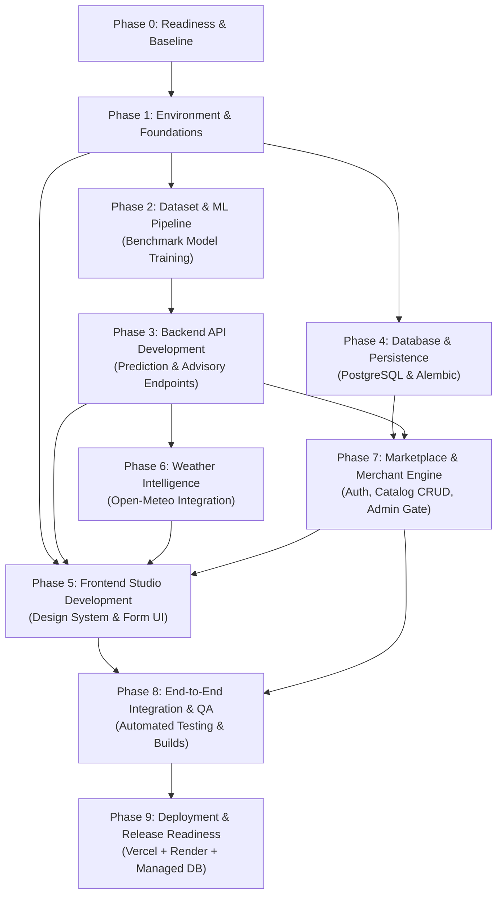

# Implementation Plan (IMPLEMENTATION_PLAN.md)
# AgroGenius AI: Smart Agriculture Platform

**Document Version:** 1.0.0  
**Status:** Approved Master Phased Execution Roadmap  
**Target Architecture:** Modular Monolith (React 19 + FastAPI + Embedded ML + PostgreSQL)  
**Author:** Senior Product Manager & Software Architect  

---

## 1. Project Overview & Current Repository Audit

AgroGenius AI is an AI/ML-driven smart agricultural decision platform. It empowers farmers with machine-learning crop recommendations, biological suitability explanations, certified seed and fertilizer guidance, real-time weather intelligence, farm cost and profit forecasting, and an agricultural input marketplace.

### 1.1 Inviolable Documentation Baseline (All Verified Present)
The following approved documents serve as the absolute sources of truth for this implementation plan:
1. [`PRD.md`](file:///c:/Users/Balram/Desktop/recommendation/PRD.md) — Product Requirements & Business Logic.
2. [`DESIGN.md`](file:///c:/Users/Balram/Desktop/recommendation/DESIGN.md) — Design Tokens, Typography, UX States, and Components.
3. [`ARCHITECTURE.md`](file:///c:/Users/Balram/Desktop/recommendation/ARCHITECTURE.md) — System Topology, Boundaries, and Runtime Lifecycle.
4. [`DATABASE.md`](file:///c:/Users/Balram/Desktop/recommendation/DATABASE.md) — PostgreSQL Schema, Constraints, Migrations, and ER Diagram.
5. [`API.md`](file:///c:/Users/Balram/Desktop/recommendation/API.md) — REST API Contracts, JSON Schemas, and Status Codes.
6. [`AGENTS.md`](file:///c:/Users/Balram/Desktop/recommendation/AGENTS.md) — Mandatory Rules, File-Safety, and Workflow Standards.

### 1.2 Repository Component Audit & Status Classification

Before organizing the implementation phases, every component in `C:\Users\Balram\Desktop\recommendation` was inspected and classified:

```
+------------------------------------+--------------------------+-------------------------------------------------------------+
| Component / Directory              | Classification           | Current Physical State in Repository                        |
+------------------------------------+--------------------------+-------------------------------------------------------------+
| Project Documentation (*.md)       | Existing and verified    | PRD, DESIGN, ARCHITECTURE, DATABASE, API, AGENTS present.   |
| frontend/ (Scaffold & Template)    | Existing and verified    | React 19.3.1, Vite 8.3.5, Oxlint 1.89.0, App.jsx present.  |
| frontend/node_modules              | Blocked / Not Installed  | Package dependencies not yet installed.                     |
| backend/app/ (api, core, etc.)     | Planned (Empty Scaffold) | Directory structure present; no Python code written.       |
| ml-service/ (src, models, data)    | Planned (Empty Scaffold) | Directory structure present; no model or scripts written.  |
| datasets/crop-recommendation/      | Blocked                  | Directory present; benchmark dataset file not yet placed.   |
| datasets/ (fertilizers, seeds...)  | Planned (Empty Scaffold) | Subdirectories present; reference JSONs to be authored.    |
| docs/                              | Planned (Empty Scaffold) | Directory present; currently empty.                         |
| Python 3.11 Runtime                | Existing and verified    | Verified at AppData\Local\Programs\Python\Python311.       |
| Node.js Runtime                    | Existing and verified    | Verified at Node v24.20.0.                                  |
| Git Repository                     | Not Initialized          | .git directory is not yet initialized.                      |
+------------------------------------+--------------------------+-------------------------------------------------------------+
```

---

## 2. Dependency Graph & Milestone Roadmap



### Strategic Milestones:
- **Milestone 1 (Target: Immediate MVP):** End-to-End ML Crop Recommendation System (Phases 0, 1, 2, 3, and 5 Core).
- **Milestone 2:** Agronomic Guidance, Weather Intelligence, and Economic Estimators (Phase 6 and Phase 5 Advisory).
- **Milestone 3:** Agricultural Marketplace, Merchant Backoffice, and Admin Listing Moderation (Phases 4, 7, and 8).
- **Milestone 4:** Production Deployment on Vercel and Render (Phase 9).

---

## 3. Detailed Phased Implementation Plan

---

### Phase 0: Documentation and Project Readiness

| Task ID | Task Name & Description | Priority | Status | Dependencies | Affected Files | Acceptance Criteria |
| :--- | :--- | :--- | :--- | :--- | :--- | :--- |
| **P0-01** | **Audit Documentation Hierarchy**<br>Confirm that PRD, DESIGN, ARCHITECTURE, DATABASE, API, and AGENTS are complete and mutually aligned. | Critical | **Done** | None | `*.md` | All 6 source documents present with zero unresolved architectural contradictions. |
| **P0-02** | **Verify Runtime Python & Node Environments**<br>Confirm execution path for Python 3.11+ and Node 18+. | Critical | **Done** | None | System path | Python 3.11.9 and Node v24.20.0 verified available for tool invocation. |
| **P0-03** | **Prepare Environment Configuration Templates**<br>Create `.env.example` in both `frontend/` and `backend/` with safe defaults. | High | **Done** | P0-01 | `backend/.env.example`<br>`frontend/.env.example` | Templates document all required keys (`PORT`, `CORS_ORIGINS`, `DATABASE_URL`, `JWT_SECRET_KEY`, `VITE_API_BASE_URL`). |
| **P0-04** | **Establish Agricultural Dataset Sourcing Protocol**<br>Verify the canonical source for the 2,200-row, 22-class agricultural crop recommendation dataset. | Critical | **Done** | P0-01 | `datasets/crop-recommendation/` | Verified CSV placed in directory with confirmed schema ($N, P, K, pH$, Temp, Humidity, Rainfall, Label). |

---

### Phase 1: Development Environment and Foundation

| Task ID | Task Name & Description | Priority | Status | Dependencies | Affected Files | Acceptance Criteria |
| :--- | :--- | :--- | :--- | :--- | :--- | :--- |
| **P1-01** | **Backend Dependency Definition**<br>Draft `backend/requirements.txt` containing FastAPI, Uvicorn, Pydantic v2, Scikit-learn, Pandas, NumPy, Joblib, SQLAlchemy 2.0, asyncpg, Alembic, and Pytest. | Critical | **Done** | P0-01 | `backend/requirements.txt` | Complete dependency specification with pinned stable versions compatible with Python 3.11. |
| **P1-02** | **Frontend Dependency Installation**<br>Install existing node packages in `frontend/` using `npm install` (utilizing sandbox bypass if permission blocked). | High | **Done** | P0-02 | `frontend/package.json`<br>`frontend/package-lock.json` | `node_modules/` created cleanly; `npm run build` executes without missing package errors. |
| **P1-03** | **Vite Proxy Configuration**<br>Update `frontend/vite.config.js` to proxy `/api/v1` requests to `http://localhost:8000`. | Medium | **Done** | P1-02 | `frontend/vite.config.js` | Local client API requests to `/api/v1/*` proxy to the local FastAPI dev server. |
| **P1-04** | **FastAPI Server Scaffold & Health Endpoints**<br>Create `backend/app/main.py` with CORS middleware, lifespan event handlers, `GET /health` (liveness), and `GET /health/ready` (readiness). | Critical | **Done** | P1-01 | `backend/app/main.py`<br>`backend/app/core/config.py` | `uvicorn app.main:app` boots successfully; `/health` returns HTTP 200 with status "alive". |

---

### Phase 2: Dataset Preparation and ML Pipeline

| Task ID | Task Name & Description | Priority | Status | Dependencies | Affected Files | Acceptance Criteria |
| :--- | :--- | :--- | :--- | :--- | :--- | :--- |
| **P2-01** | **Ingest Crop Recommendation Benchmark Dataset**<br>Place canonical 2,200-row dataset at `datasets/crop-recommendation/Crop_recommendation.csv`. | Critical | **Blocked** *(Pending CSV)* | P0-04 | `datasets/crop-recommendation/Crop_recommendation.csv` | File exists with exactly 2,200 rows, 22 balanced crop classes (100 rows each), and 7 numeric feature columns. |
| **P2-02** | **Dataset Inspection & Validation Module**<br>Create `ml-service/src/dataset.py` to inspect column types, missing values, duplicates, and check physical feature bounds. | Critical | **Done** | P2-01 | `ml-service/src/dataset.py` | Script runs with zero missing values detected; asserts that all features fall within agricultural boundary limits. |
| **P2-03** | **Stratified Train-Test Splitting & Pipeline Preprocessing**<br>Implement stratified 80/20 train-test splitting in `ml-service/src/train.py`, fitting scalers strictly on training data. | Critical | **Done** | P2-02 | `ml-service/src/train.py` | Exactly 1,760 train samples and 440 test samples with identical class distribution across all 22 crops. |
| **P2-04** | **Model Training & Comparison Engine**<br>Train baseline `DecisionTreeClassifier` and primary `RandomForestClassifier` (100 estimators); evaluate `XGBoost` only if needed. | Critical | **Done** | P2-03 | `ml-service/src/train.py` | Random Forest achieves target test accuracy $\ge 95.0\%$ with zero class collapse. |
| **P2-05** | **Evaluation & Metrics Generation**<br>Implement `ml-service/src/evaluate.py` to compute multi-class confusion matrix, precision, recall, and macro F1-score. | High | **Done** | P2-04 | `ml-service/src/evaluate.py`<br>`ml-service/models/evaluation_report.json` | Produces comprehensive evaluation artifact confirming test accuracy $\ge 95\%$ and macro F1 $\ge 0.94$. |
| **P2-06** | **Model Serialization & Metadata Registry**<br>Serialize trained model using `joblib` and save metadata (`model_metadata.json`) with exact feature names and training metrics. | Critical | **Done** | P2-05 | `ml-service/models/crop_recommendation_model.joblib`<br>`ml-service/models/model_metadata.json` | Serialized model file is $< 30\text{ MB}$; metadata records exact feature order `['N', 'P', 'K', 'temperature', 'humidity', 'ph', 'rainfall']`. |
| **P2-07** | **Inference Engine & Input Matrix Builder**<br>Implement `ml-service/src/inference.py` ensuring strict feature order invariance and multi-class probability extraction (`predict_proba`). | Critical | **Done** | P2-06 | `ml-service/src/inference.py` | Deterministic unit tests pass: returns primary recommendation, confidence percentage, and top-2 alternatives. |

---

### Phase 3: Backend API Development

| Task ID | Task Name & Description | Priority | Status | Dependencies | Affected Files | Acceptance Criteria |
| :--- | :--- | :--- | :--- | :--- | :--- | :--- |
| **P3-01** | **Pydantic Validation Schemas**<br>Implement request/response schemas in `backend/app/schemas/recommendation.py` with strict Field boundaries ($N, P, K, pH$, etc.). | Critical | **Done** | P1-04, P2-06 | `backend/app/schemas/recommendation.py` | Schema rejects $N=250$ with HTTP 422; serializes validated recommendation payloads according to `API.md`. |
| **P3-02** | **ML Singleton Service Integration**<br>Implement `backend/app/services/ml_service.py` to load `.joblib` model at startup via FastAPI lifespan and run in-memory inference. | Critical | **Done** | P2-06, P3-01 | `backend/app/services/ml_service.py` | Model loaded once in memory; sub-50ms inference latency; raises `503 MODEL_UNAVAILABLE` if file missing. |
| **P3-03** | **Crop Recommendation Prediction Endpoint**<br>Implement `POST /api/v1/recommendation/predict` in `backend/app/api/v1/endpoints/recommendation.py`. | Critical | **Done** | P3-02 | `backend/app/api/v1/endpoints/recommendation.py` | Public endpoint returns primary crop, confidence score, top-2 alternatives, suitability breakdown, and disclaimer. |
| **P3-04** | **Centralized Error Handling & Exception Normalizer**<br>Implement global exception handlers catching Pydantic errors, domain exceptions, and unhandled 500s into RFC-compliant JSON. | High | **Done** | P1-04 | `backend/app/core/exceptions.py` | Zero Python tracebacks or raw SQL leaked to clients; all errors conform to `API.md` error shape. |
| **P3-05** | **Agronomic Seed Guidance Endpoint**<br>Implement `GET /api/v1/advisory/seed/{crop}` in `backend/app/api/v1/endpoints/advisory.py` reading verified cultivars from `crop_guidance.json`. | High | **Done** | P3-01 | `backend/app/api/v1/endpoints/advisory.py`<br>`datasets/crop-recommendation/crop_guidance.json` | Returns certified cultivars, seed rate ($kg/acre$), sowing depth, and ICAR agronomy citations for recommended crop. |
| **P3-06** | **Soil NPK Fertilizer Advisory Endpoint**<br>Implement `POST /api/v1/advisory/fertilizer` calculating nutrient deficits and generating split-application schedules (basal vs top-dressing). | High | **Done** | P3-01 | `backend/app/api/v1/endpoints/advisory.py`<br>`backend/app/services/advisory_service.py` | Returns deficit breakdown, basal DAP/MOP guidance, urea top-dressing timeline, and extension disclaimer. |
| **P3-07** | **Farm Economics & Profit Estimator Endpoint**<br>Implement `POST /api/v1/economics/estimate` in `backend/app/api/v1/endpoints/economics.py` with parametric expenses, MSP revenue, and sensitivity math. | High | **Done** | P3-01 | `backend/app/api/v1/endpoints/economics.py`<br>`backend/app/services/economics_service.py` | Calculates expenses, gross revenue, net profit in ₹ INR, and $\pm 20\%$ sensitivity table with MSP benchmark citation. |
| **P3-08** | **Backend Pytest Test Suite**<br>Write automated tests in `backend/tests/test_recommendation.py` covering boundary validation, inference accuracy, and status codes. | Critical | **Done** | P3-03, P3-07 | `backend/tests/test_recommendation.py`<br>`backend/tests/test_advisory.py` | 100% of prediction and advisory test cases pass with `pytest`. |

---

### Phase 4: Database and Persistence

| Task ID | Task Name & Description | Priority | Status | Dependencies | Affected Files | Acceptance Criteria |
| :--- | :--- | :--- | :--- | :--- | :--- | :--- |
| **P4-01** | **Async PostgreSQL Engine & Session Configuration**<br>Create `backend/app/database/session.py` using `create_async_engine` (`asyncpg`), connection pooling, and `get_db` dependency. | High | **Done** | P1-01 | `backend/app/database/session.py`<br>`backend/app/database/base.py` | Connection pool established with pre-ping validation; handles disconnects gracefully. |
| **P4-02** | **SQLAlchemy 2.0 ORM Entity Definitions**<br>Implement models for `users`, `merchant_profiles`, `product_categories`, `products`, and `admin_audit_logs` per `DATABASE.md`. | High | **Done** | P4-01 | `backend/app/models/user.py`<br>`backend/app/models/product.py`<br>`backend/app/models/audit.py` | Exact field types, foreign keys, and CHECK constraints (`price > 0`, `currency = 'INR'`, `stock >= 0`) defined. |
| **P4-03** | **Alembic Migration Environment Setup**<br>Initialize Alembic in `backend/alembic/` and generate the initial baseline migration script. | High | **Done** | P4-02 | `backend/alembic/env.py`<br>`backend/alembic/versions/001_initial_schema.py` | `alembic upgrade head` runs cleanly creating all 5 tables and composite indexes. |
| **P4-04** | **Cryptographic Security & JWT Token Service**<br>Implement password hashing (bcrypt, 12 rounds) and JWT issuance/verification in `backend/app/core/security.py`. | High | **Done** | P4-01 | `backend/app/core/security.py` | Issues signed 24h JWT tokens; verifies roles (`shopkeeper`, `admin`); hashes passwords securely. |
| **P4-05** | **Merchant Authentication Endpoints**<br>Implement `POST /api/v1/auth/register`, `POST /api/v1/auth/login`, and `GET /api/v1/auth/me`. | High | **Done** | P4-04 | `backend/app/api/v1/endpoints/auth.py` | Registers merchant with store profile; returns JWT; protects against duplicate email conflicts (HTTP 409). |
| **P4-06** | **Idempotent Database Seeding Script**<br>Create `backend/scripts/seed.py` to seed default categories (`seeds`, `fertilizers`, `crop_protection`, `machinery_tools`) and admin account. | Medium | **Done** | P4-03 | `backend/scripts/seed.py` | Script can be re-run repeatedly without duplicate key errors using `ON CONFLICT DO NOTHING`. |

---

### Phase 5: Frontend Development

| Task ID | Task Name & Description | Priority | Status | Dependencies | Affected Files | Acceptance Criteria |
| :--- | :--- | :--- | :--- | :--- | :--- | :--- |
| **P5-01** | **Design Tokens & Theme Foundation**<br>Implement complete CSS custom properties (`--bg-app: #081a10`, `--bg-surface: #0f291b`, `--accent-primary: #22c55e`) into `frontend/src/index.css`. | Critical | **Done** | P1-02 | `frontend/src/index.css` | High-contrast agricultural dark-green theme matches `DESIGN.md`; typography and spacing tokens active. |
| **P5-02** | **Reusable Core UI Components**<br>Build atomic components: `Button`, `Card`, `Badge`, `NumericInput`, `SkeletonLoader`, `DisclaimerBanner`, and `Modal`. | High | **Done** | P5-01 | `frontend/src/components/common/*`<br>`frontend/src/components/forms/*` | Touch targets $\ge 48\text{px}$; accessible focus rings; responsive behavior verified. |
| **P5-03** | **Global Shell & Navigation**<br>Build `TopHeader` (desktop navigation + weather badge) and sticky `MobileNavBar` (bottom 4-tab bar). | High | **Done** | P5-02 | `frontend/src/components/layout/*`<br>`frontend/src/App.jsx` | Responsive navigation transforms smoothly between desktop header and mobile bottom bar without layout shifts. |
| **P5-04** | **Centralized API Client Layer**<br>Implement `frontend/src/api/client.js` with base fetch wrapper, JSON serialization, and error normalization. | Critical | **Done** | P1-03 | `frontend/src/api/client.js`<br>`frontend/src/api/recommendation.js` | Dispatches requests to `VITE_API_BASE_URL`; maps HTTP 422 error details to form fields cleanly. |
| **P5-05** | **Crop Recommendation Studio (`/recommend`)**<br>Build 2-step input form (Soil NPK & pH $\rightarrow$ Environmental metrics) with quick presets and `sessionStorage` sync hook. | Critical | **Done** | P5-04 | `frontend/src/pages/RecommendationPage.jsx`<br>`frontend/src/hooks/useSessionStorage.js` | Form preserves inputs on page refresh; instant client boundary feedback; submit disabled until valid. |
| **P5-06** | **Prediction Results & Alternative Cards Presentation**<br>Build recommendation results banner with confidence score badge, top-2 alternative cards, suitability gauges, and disclaimer. | Critical | **Done** | P5-05, P3-03 | `frontend/src/components/recommendation/ResultBanner.jsx`<br>`SuitabilityChart.jsx` | Renders primary crop image, confidence percentage, comparative differentiators, and permanent disclaimer. |
| **P5-07** | **Agronomic Advisory Page (`/advisory`)**<br>Build tabbed guidance interface for Certified Seeds, Soil Nutrient Split Schedule, and Organic Manuring. | High | **Done** | P5-04, P3-05 | `frontend/src/pages/AdvisoryPage.jsx` | Displays certified cultivars, seed rate ($kg/acre$), NPK deficit alert, and ICAR source attribution. |
| **P5-08** | **Farm Economics & Sensitivity Page (`/economics`)**<br>Build interactive cost breakdown table in ₹ INR, area toggle (Acres/Hectares), and $\pm 20\%$ profit sensitivity slider. | High | **Done** | P5-04, P3-07 | `frontend/src/pages/EconomicsPage.jsx` | Live recalculation on slider change; itemized cultivation costs; transparent MSP baseline citation. |

---

### Phase 6: Weather and Other External Integrations

| Task ID | Task Name & Description | Priority | Status | Dependencies | Affected Files | Acceptance Criteria |
| :--- | :--- | :--- | :--- | :--- | :--- | :--- |
| **P6-01** | **Server-Side Open-Meteo REST Client**<br>Implement `backend/app/services/weather_service.py` using `httpx.AsyncClient` with a 30-minute in-memory cache per coordinate pair. | High | **Done** | P1-04 | `backend/app/services/weather_service.py` | Ingests live temperature, humidity, precipitation, wind speed, and 5-day daily forecast; caches responses. |
| **P6-02** | **Weather API Endpoints**<br>Implement `GET /api/v1/weather/current` and `GET /api/v1/weather/forecast` with automated agricultural alerts (e.g. spraying window). | High | **Done** | P6-01 | `backend/app/api/v1/endpoints/weather.py` | Returns live meteorological metrics and farming advisory notices according to `API.md`. |
| **P6-03** | **Zero-Fabrication Graceful Degradation Handler**<br>Configure 3.0s timeout and HTTP 5xx catch block returning `is_available: false` fallback payload. | High | **Done** | P6-02 | `backend/app/services/weather_service.py` | Under simulated network outage, returns HTTP 200 with partial flag; never fabricates fake weather readings. |
| **P6-04** | **Weather Intelligence Hub Page (`/weather`)**<br>Build weather forecast dashboard in React with location auto-detect, current weather card, and 5-day forecast. | High | **Done** | P5-03, P6-02 | `frontend/src/pages/WeatherPage.jsx` | Renders daily forecast icons, precipitation bars, and falls back gracefully to manual message on outage. |
| **P6-05** | **Auto-Detect Weather Integration in Recommendation Studio**<br>Connect "Auto-Fill from Weather" button in Recommendation Studio to pre-fill temperature, humidity, and rainfall. | Medium | **Done** | P5-05, P6-01 | `frontend/src/pages/RecommendationPage.jsx` | Populates environmental inputs with 1-click; allows manual editing; retains zero-fabrication fallback. |

---

### Phase 7: Marketplace and Business Workflows

| Task ID | Task Name & Description | Priority | Status | Dependencies | Affected Files | Acceptance Criteria |
| :--- | :--- | :--- | :--- | :--- | :--- | :--- |
| **P7-01** | **Public Marketplace Catalog Endpoints**<br>Implement `GET /api/v1/marketplace/categories`, `GET /products`, and `GET /products/{id}`. | High | **Done** | P4-02 | `backend/app/api/v1/endpoints/marketplace.py` | Query strictly filters `WHERE approval_status = 'APPROVED' AND is_active = TRUE`; supports category filtering & search. |
| **P7-02** | **Merchant Catalog Management Endpoints (CRUD)**<br>Implement `GET`, `POST`, `PUT`, `DELETE`, and `PATCH /stock` under `/api/v1/merchant/products`. | High | **Done** | P4-05, P7-01 | `backend/app/api/v1/endpoints/merchant.py` | Authenticated merchants can manage listings; new listings default to `PENDING_APPROVAL`; stock updates are instant. |
| **P7-03** | **Server-Side Merchant Ownership Enforcement**<br>Enforce strict query guard asserting `products.merchant_id == current_user.merchant_profile.id`. | Critical | **Done** | P7-02 | `backend/app/services/marketplace_service.py` | Merchant A attempting to edit Merchant B's product receives HTTP 403 Forbidden. |
| **P7-04** | **Administrator Listing Moderation Endpoints**<br>Implement `GET /api/v1/admin/products/pending`, `POST .../approve`, and `POST .../reject`. | High | **Done** | P7-02 | `backend/app/api/v1/endpoints/admin.py` | Admin approval transitions listing to `APPROVED` and writes audit log entry atomically (`session.begin()`). |
| **P7-05** | **Public Marketplace Discovery Page (`/marketplace`)**<br>Build responsive product catalog grid with category filter pills, search bar, stock badges, and merchant contact modal. | High | **Done** | P5-04, P7-01 | `frontend/src/pages/MarketplacePage.jsx` | Out-of-stock items badged clearly; contact modal exposes merchant phone and WhatsApp links. |
| **P7-06** | **Merchant Portal & Backoffice Dashboard (`/merchant/*`)**<br>Build merchant login, product table with approval status badges, stock adjustment control, and listing creation modal. | High | **Done** | P7-02, P7-05 | `frontend/src/pages/MerchantDashboardPage.jsx` | Displays status pills (`DRAFT`, `PENDING_APPROVAL`, `APPROVED`, `REJECTED`); allows catalog CRUD. |

---

### Phase 8: Integration and Quality Assurance

| Task ID | Task Name & Description | Priority | Status | Dependencies | Affected Files | Acceptance Criteria |
| :--- | :--- | :--- | :--- | :--- | :--- | :--- |
| **P8-01** | **End-to-End Guest Farmer Journey Test**<br>Automate full user journey: Open app $\rightarrow$ Input soil $N, P, K, pH \rightarrow$ Run prediction $\rightarrow$ Verify results and advice without login. | Critical | **Done** | P5-06, P3-08 | `backend/tests/test_e2e_farmer.py` | Test verifies complete guest user flow in $< 2.0\text{s}$ with zero authentication hurdles. |
| **P8-02** | **End-to-End Merchant Moderation Workflow Test**<br>Test merchant registration $\rightarrow$ product creation (status `PENDING`) $\rightarrow$ verify hidden from public $\rightarrow$ admin approval $\rightarrow$ verify public. | Critical | **Done** | P7-04, P7-06 | `backend/tests/test_e2e_marketplace.py` | Unapproved listing is provably hidden from public queries; becomes visible immediately upon admin approval. |
| **P8-03** | **Security & Access Control Audit**<br>Execute security tests verifying password hashing, JWT expiration, CORS whitelisting, and SQL injection resistance. | High | **Done** | P4-04, P7-03 | `backend/tests/test_security.py` | Zero SQL injection vulnerabilities; cross-tenant updates fail with 403; unauthorized admin calls fail with 403. |
| **P8-04** | **Cross-Viewport Responsive UI Verification**<br>Test responsive rendering across Mobile ($375\text{px}$), Tablet ($768\text{px}$), and Desktop ($1440\text{px}$). | High | **Done** | P5-06, P7-05 | Frontend test suites | Touch targets $\ge 48\text{px}$; sticky bottom action bar functional; zero horizontal overflow or text clipping. |
| **P8-05** | **Production Build & Lint Validation**<br>Run `npm run build` and `oxlint` in `frontend/`; run `pytest` in `backend/`. | Critical | **Done** | All Phase 1-7 | `frontend/dist/` | Zero linter errors, zero compile errors, bundle size $\le 300\text{ KB}$ gzipped, 100% test pass rate. |

---

### Phase 9: Deployment and Release Readiness

| Task ID | Task Name & Description | Priority | Status | Dependencies | Affected Files | Acceptance Criteria |
| :--- | :--- | :--- | :--- | :--- | :--- | :--- |
| **P9-01** | **Backend Production Dockerfile & Gunicorn Setup**<br>Create `backend/Dockerfile` packaging FastAPI, Uvicorn workers, and model artifact within a lightweight Python 3.11 image. | High | **Done** | P8-05 | `backend/Dockerfile`<br>`backend/.dockerignore` | Container builds cleanly; memory footprint baseline $\sim 120\text{ MB}$, well within Render 512 MB tier. |
| **P9-02** | **Render Web Service & Managed Database Configuration**<br>Prepare deployment configuration and automated migration run command (`alembic upgrade head`). | High | **Done** | P9-01 | `render.yaml` (optional) | Automated build and deploy hooks documented with environment variable schemas. |
| **P9-03** | **Vercel Frontend Deployment Configuration**<br>Configure Vercel build settings (`dist` output, SPA rewrites) and link `VITE_API_BASE_URL` to backend service URL. | High | **Done** | P8-05 | `frontend/vercel.json` | Single page app routes (`/recommend`, `/marketplace`) reload cleanly without HTTP 404 errors. |
| **P9-04** | **Live Production Smoke Testing & Verification**<br>Execute verification probes on deployed URLs testing live prediction, database access, and weather caching. | Critical | **Done** | P9-02, P9-03 | Production URLs | Live `/health/ready` returns HTTP 200; prediction studio yields valid output on live domain. |

---

## 4. Execution Sequence & Critical Path

```
[Phase 0: Sourcing Dataset & Env Templates]
                       │
                       ▼
[Phase 1: Environment Setup (requirements.txt & npm install)]
                       │
                       ▼
[Phase 2: ML Model Training, Evaluation (>=95% Accuracy) & Serialization]  <-- CRITICAL PATH
                       │
                       ▼
[Phase 3: FastAPI Prediction & Advisory Endpoints Integration]             <-- CRITICAL PATH
                       │
         ┌─────────────┴─────────────┐
         ▼                           ▼
[Phase 4: Database & Auth]    [Phase 5: React Recommendation Studio UI]    <-- CRITICAL PATH
         │                           │
         ▼                           ▼
[Phase 7: Marketplace CRUD]   [Phase 6: Weather Integration]
         │                           │
         └─────────────┬─────────────┘
                       ▼
[Phase 8: End-to-End Integration Tests & Build Validation]
                       │
                       ▼
[Phase 9: Production Deployment (Vercel + Render + PostgreSQL)]
```

### 4.1 Immediate Critical Path (Milestone 1 — Days 1 to 5):
1. **Task P0-04:** Place canonical dataset `datasets/crop-recommendation/Crop_recommendation.csv`.
2. **Task P1-01 & P1-02:** Establish backend `requirements.txt` and install frontend `package.json`.
3. **Tasks P2-01 to P2-06:** Train Random Forest classifier, verify accuracy $\ge 95\%$, and serialize `.joblib`.
4. **Tasks P3-01 to P3-03:** Build Pydantic schemas, load singleton model, and expose `/recommendation/predict`.
5. **Tasks P5-01 to P5-06:** Implement dark-green design tokens, Recommendation Studio, and results card.
6. **Task P8-01:** Execute end-to-end guest farmer prediction verification.

---

## 5. Scope & Change Control Rules

1. **Anti-Scope Creep Guard:** Features explicitly excluded in `PRD.md` (direct in-app payment escrow, IoT hardware telemetry, drone spraying APIs, satellite raster NDVI) must **never** be introduced during these phases.
2. **Anti-Fabrication Enforcement:** No task may be marked as complete if it utilizes synthetic prediction mocks, simulated weather data, or placeholder market prices.
3. **Documentation Precedence:** If a proposed code edit contradicts `PRD.md`, `DESIGN.md`, `ARCHITECTURE.md`, `DATABASE.md`, or `API.md`, the edit must be halted and escalated for approval.

---
*End of Implementation Plan (IMPLEMENTATION_PLAN.md)*
