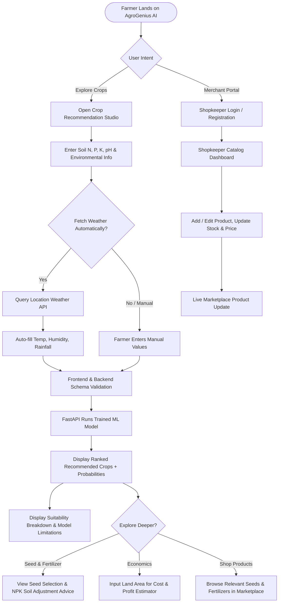
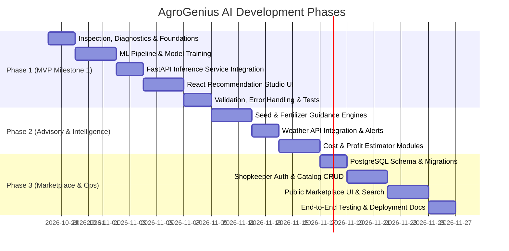

# Product Requirements Document (PRD)
# AgroGenius AI: Smart Agriculture Platform

**Document Version:** 1.0.0  
**Status:** Approved for Architecture & Milestone Implementation  
**Target Milestone:** Phase 1 (MVP - End-to-End ML Crop Recommendation) through Phase 3 (Connected Agricultural Services & Marketplace)  
**Author:** Senior Product Manager & Software Architect  

---

## 1. Product Overview

AgroGenius AI is an AI/ML-powered smart agriculture platform engineered to empower smallholder and commercial farmers with data-driven agronomic decision intelligence. The platform combines machine learning predictive models, real-time weather intelligence, agronomic nutrient and seed guidance, cultivation cost and profit forecasting, and a localized agricultural marketplace.

By bridging empirical soil analysis, meteorological observations, and agronomic domain knowledge into a cohesive, responsive web application, AgroGenius AI mitigates financial risks, eliminates subjective guesswork, and optimizes yield potentials for agricultural producers.

### 1.1 Product Identity & Principles
- **Product Name:** AgroGenius AI
- **Core Promise:** Data-backed, transparent, and actionable agricultural intelligence accessible to every farmer without technical or bureaucratic barriers.
- **Foundational Integrity Rule:** **Zero Fabrication**. No synthetic or hardcoded crop predictions, fabricated weather metrics, invented market prices, or artificial yield claims are permitted. All outputs must derive from trained ML models, verified APIs, authenticated shopkeeper records, or explicitly stated agronomic baseline formulas.
- **Accessibility Rule:** **No Forced Registration for Farmers**. The primary crop recommendation and guidance capabilities must remain frictionless and immediately usable as a guest user.

---

## 2. Problem Statement

Modern agriculture is exposed to volatile climate patterns, degrading soil health, and volatile commodity markets. Farmers consistently face critical decision bottlenecks:

1. **Suboptimal Crop Selection:** Farmers frequently select crops based on ancestral tradition or peer imitation rather than empirical soil chemistry (N, P, K, pH) and environmental parameters (rainfall, temperature, humidity). This results in crop failure, stunted yields, or depleted soil vitality.
2. **Imbalanced Chemical Inputs:** In the absence of scientific nutrient advisories, farmers either under-fertilize or over-apply chemical nitrogen, phosphorus, and potassium, increasing operating costs and causing long-term soil toxicity.
3. **Weather Vulnerability:** Sudden precipitation deficits or heatwaves destroy standing crops when farmers lack timely localized forecasts and actionable weather-linked warnings.
4. **Opaque Financial Planning:** Cultivation expenses (seeds, tillage, labor, irrigation, fertilizer) and potential gross profits are rarely calculated before sowing, leaving farmers unaware of their break-even thresholds.
5. **Agricultural Supply Asymmetry:** Sourcing authentic seeds, fertilizers, and equipment from verified local merchants is fragmented, leading to reliance on unverified middlemen or counterfeit agricultural inputs.

---

## 3. Product Vision and Value Proposition

### 3.1 Long-Term Vision
To become the definitive open-access agricultural decision operating system for farmers across rural and semi-urban agricultural belts, driving sustainable cultivation, climate resilience, and financial viability.

### 3.2 Value Propositions
- **For Farmers:**
  - *Frictionless Intelligence:* Access high-accuracy crop recommendations within seconds without mandatory account creation.
  - *Explainable Agronomics:* Understand *why* a crop is recommended through transparent environmental and soil suitability breakdowns.
  - *Economic Predictability:* Pre-calculate cultivation expenditures and projected net profits before investing capital.
  - *Direct Sourcing:* Discover verified agricultural inputs from local merchants with real-time stock and transparent pricing.
- **For Agricultural Shopkeepers:**
  - *Digital Storefront:* Reach local farmers actively searching for seeds, fertilizers, and farm equipment.
  - *Inventory Transparency:* Showcase real inventory, genuine certifications, and accurate pricing.

---

## 4. Target Users and User Needs

### 4.1 Target Personas

| Persona | Role / Description | Primary Needs | Key Pain Points | Tech Literacy |
| :--- | :--- | :--- | :--- | :--- |
| **Persona 1: Progressive Smallholder Farmer ("Ram")** | Owns 2–5 acres of arable land; relies on seasonal cash and food crops. | - Quick, accurate crop suggestions based on soil test card or regional norms.<br>- Clear fertilizer and seed guidance.<br>- Simple localized weather alerts. | - High cost of farm inputs.<br>- Unpredictable weather.<br>- Complex software with mandatory signups. | Moderate (Smartphone user, prefers clean UI, responsive mobile web). |
| **Persona 2: Commercial Farmer / Estate Manager ("Priya")** | Manages 10+ acres; multi-crop cultivation with commercial focus. | - Cultivation cost breakdown per acre.<br>- Yield and profit risk estimations.<br>- Multi-crop alternative ranking. | - Unhedged market price swings.<br>- Suboptimal input allocation across plots. | Moderate to High (Mobile & Desktop user). |
| **Persona 3: Agricultural Input Merchant ("Suresh")** | Operates a registered local seed, fertilizer, and agro-equipment store. | - Simple portal to list products, manage inventory, and update prices.<br>- Reaching farmers in neighboring villages. | - Slow inventory turnover.<br>- Inability to reach digital-first farmers. | Moderate (Web browser / tablet user). |
| **Persona 4: Agronomist / Extension Officer ("Dr. Anita")** | Agricultural consultant guiding regional farming communities. | - Scientific explanation of ML outputs.<br>- Clear disclaimers on model limitations.<br>- Cross-referencing soil chemistry with NPK standards. | - Misinformation and over-promising AI tools that mislead farmers. | High (Desktop/tablet user). |

---

## 5. Product Goals and Measurable Objectives

### 5.1 Business & Impact Goals
- Deliver a production-grade, responsive smart agriculture platform within the designated architectural framework.
- Enable farmers to complete a crop prediction in under **30 seconds** from landing on the website.
- Maintain **100% data integrity**: zero fabricated predictions, synthetic weather data, or illusory profit guarantees.

### 5.2 Technical & Model Performance Goals
- **ML Crop Recommendation Accuracy:** Achieve $\ge 95\%$ test accuracy on validated multi-class crop datasets (e.g. standard 22-class agricultural dataset).
- **Backend Prediction Latency:** P95 response time $\le 250\text{ ms}$ for the ML inference endpoint.
- **Weather API Integration:** P95 response time $\le 800\text{ ms}$ with in-memory/cache fallback for upstream weather API timeouts.
- **Client Performance:** Google Lighthouse score $\ge 90$ for Performance, Accessibility, and Best Practices on mobile viewports.

---

## 6. Core User Journeys



### 6.1 Journey 1: Frictionless Crop Recommendation (Guest Farmer)
1. Farmer lands on the home dashboard. No registration modal or gate appears.
2. Farmer navigates to the **Crop Recommendation Studio**.
3. Farmer enters soil parameters: Nitrogen (N), Phosphorus (P), Potassium (K), and soil pH.
4. Farmer either enters local environmental conditions (Temperature, Humidity, Rainfall) manually or clicks **"Auto-Detect from Weather"** based on device geolocation or city selection.
5. The system performs client-side validation against valid agronomic bounds and submits the payload to `/api/v1/recommendation/predict`.
6. The FastAPI backend validates parameters via Pydantic and executes inference using the serialized Scikit-learn model.
7. The interface renders the primary recommended crop with a confidence score, accompanied by ranked alternative crops, feature contribution indicators, and a mandatory agronomic disclaimer.

### 6.2 Journey 2: Advisory & Economic Decision Support
1. Directly from the crop recommendation card, the farmer clicks **"View Agronomic & Financial Guidance"**.
2. Seed guidance displays certified seed varieties, germination rates, and sowing depth standards.
3. Fertilizer guidance highlights target soil NPK differentials and recommended basal/top-dressing practices.
4. The farmer inputs land size (e.g. 2.5 acres).
5. The **Cultivation Cost Estimator** calculates total input, labor, and irrigation expenses based on regional baseline parameters.
6. The **Profit Estimator** applies average regional yield baselines and current minimum support prices (MSP) / wholesale price ranges to compute estimated gross revenue and net profit margins, explicitly listing all assumptions.

### 6.3 Journey 3: Marketplace Discovery & Merchant Management
1. **Farmer Flow:** Farmer navigates to the **Agricultural Marketplace**, filters products by category ("Seeds", "Fertilizers", "Pesticides", "Equipment"), searches for specific recommended items, views merchant contact/location, price, and current stock status.
2. **Shopkeeper Flow:** Merchant clicks **"Merchant Portal"**, registers/authenticates via secure credentials, accesses their catalog dashboard, adds a new product with verified specifications and stock count, updates prices, or toggles availability.

---

## 7. User Stories with Acceptance Criteria

### Epic 1: ML-Based Crop Recommendation

#### US-1.1: Frictionless Input Form
- **As a** farmer,
- **I want to** enter my soil and environmental metrics without registering or logging in,
- **So that** I can obtain instant, barrier-free crop suggestions.
- **Acceptance Criteria:**
  - *Given* an unauthenticated user on the `/recommend` page,
  - *When* they view the form,
  - *Then* all 7 core inputs ($N, P, K, pH$, Temperature, Humidity, Rainfall) are visible with clearly labeled units ($kg/ha$, $pH$, $^\circ C$, $\%$, $mm$).
  - *And* no login or authentication prompt blocks form submission.

#### US-1.2: Client and Server Validation
- **As a** system,
- **I want to** validate that all input values fall within physically and agronomically plausible ranges,
- **So that** erroneous predictions caused by out-of-distribution inputs are prevented.
- **Acceptance Criteria:**
  - *Given* user enters $N = 350$ (valid range $0 - 140$) or $pH = 12.0$ (valid range $3.5 - 9.5$),
  - *When* the user attempts submission,
  - *Then* the form prevents API dispatch, highlights the erroneous field with an inline warning explaining the valid boundary.
  - *And* if invalid data bypasses the client, the FastAPI backend returns HTTP `422 Unprocessable Entity` with a structured error response detailing the violating fields.

#### US-1.3: Real ML Prediction with Confidence & Ranked Alternatives
- **As a** farmer,
- **I want to** see the top recommended crop along with viable alternative crops,
- **So that** I can make a resilient choice if the primary crop does not align with my water availability or market preference.
- **Acceptance Criteria:**
  - *Given* valid validated inputs submitted to `/api/v1/recommendation/predict`,
  - *When* the backend processes the request,
  - *Then* the response returns the predicted primary crop label, its calculated prediction probability percentage, and the next top 2 alternative crops with their respective probabilities.
  - *And* predictions are generated strictly by the trained ML pipeline (never mocked or hardcoded).

### Epic 2: Crop Suitability Explanation & Responsible AI Disclaimers

#### US-2.1: Feature Contribution Breakdown
- **As a** farmer or agronomist,
- **I want to** understand why a specific crop was recommended based on my inputs,
- **So that** I can trust the recommendations and know which soil parameters favored this crop.
- **Acceptance Criteria:**
  - *Given* a successful prediction result,
  - *When* the recommendation card is displayed,
  - *Then* the UI presents a suitability comparison chart/breakdown comparing the user's input values against the crop's typical optimal growth envelope (e.g. soil $pH$, rainfall adequacy, temperature range).

#### US-2.2: Mandatory Agronomic Limitations Disclaimer
- **As a** risk-conscious farmer,
- **I want to** see clear disclaimers regarding the predictive nature of the tool,
- **So that** I do not treat the model output as a guaranteed harvest or insurance claim.
- **Acceptance Criteria:**
  - *Given* any recommendation or profit output screen,
  - *Then* a prominent, non-dismissible agronomic disclaimer is displayed stating: *"AgroGenius AI predictions are probabilistic decision-support tools based on machine learning and empirical data. They do not constitute guaranteed yields or harvest insurance. Actual outcomes depend on unmodeled local factors including pest pressure, seed vigor, and extreme microclimatic events."*

### Epic 3: Seed & Fertilizer Agronomic Guidance

#### US-3.1: Crop-Specific Seed Information
- **As a** farmer viewing a recommended crop,
- **I want to** access verified seed guidance for that crop,
- **So that** I select certified seed varieties and observe proper seed rates.
- **Acceptance Criteria:**
  - *Given* a recommended crop (e.g., "Rice"),
  - *When* the user views the "Seed Guidance" tab,
  - *Then* the system displays standard commercial varieties, recommended seed rate ($kg/acre$), recommended sowing depth ($cm$), and optimal germination temperature.
  - *And* guidelines clearly cite established agronomic sources (e.g., ICAR/FAO standards).

#### US-3.2: Soil-Aware Fertilizer Guidance
- **As a** farmer with specific soil $N, P, K$ test values,
- **I want to** receive tailored nutrient adjustment advice,
- **So that** I avoid over-applying expensive chemical fertilizers.
- **Acceptance Criteria:**
  - *Given* user input $N=30, P=20, K=20$ for a crop requiring $N=80, P=40, K=40$,
  - *When* the guidance is generated,
  - *Then* the system identifies the nutrient deficit and suggests general organic and chemical amendment strategies (e.g., split application of Urea, DAP, or MOP).
  - *And* explicitly displays a caveat: *"Consult local agricultural extension officers for farm-specific soil testing before applying commercial chemical formulations."*

### Epic 4: Weather Intelligence & Farm Alerts

#### US-4.1: Real-Time Weather Integration
- **As a** farmer,
- **I want to** view current temperature, humidity, rainfall forecast, and wind speed for my location,
- **So that** I can schedule irrigation and spraying activities effectively.
- **Acceptance Criteria:**
  - *Given* user enters a location name or coordinates,
  - *When* weather data is requested,
  - *Then* current conditions and a 5-day daily forecast are retrieved from the integrated external weather API.
  - *And* temperature ($^\circ C$), humidity ($\%$), precipitation probability ($\%$), and wind velocity ($km/h$) are rendered clearly.

#### US-4.2: Weather Error Handling & Zero-Fabrication
- **As a** user experiencing upstream API downtime or network failure,
- **I want to** receive a transparent error message rather than fabricated weather data,
- **So that** I am not misled by outdated or imaginary meteorological information.
- **Acceptance Criteria:**
  - *Given* the external weather API fails, returns HTTP 5xx, or times out,
  - *When* the client requests weather data,
  - *Then* the backend returns a structured error and the UI renders a graceful alert: *"Real-time weather data currently unavailable. Please enter manual temperature and rainfall readings."*
  - *And* no synthetic or randomly generated weather numbers are ever populated.

### Epic 5: Cultivation Cost & Profit Estimators

#### US-5.1: Parametric Cost Estimation
- **As a** farmer planning my seasonal budget,
- **I want to** estimate total cultivation costs per acre for my recommended crop,
- **So that** I can arrange working capital before commencing field preparation.
- **Acceptance Criteria:**
  - *Given* a selected crop and user-specified land area in acres,
  - *When* the cost estimation is run,
  - *Then* the system outputs an itemized cost estimate covering: Seed costs, Soil preparation/tillage, Fertilizers & Manure, Crop protection/pesticides, Irrigation/energy, and Labor costs.
  - *And* allows the user to adjust unit costs to reflect localized pricing.

#### US-5.2: Transparent Profit & Risk Modeling
- **As a** farmer,
- **I want to** calculate estimated gross revenue and net profit under realistic yield and price assumptions,
- **So that** I can evaluate whether planting this crop makes financial sense.
- **Acceptance Criteria:**
  - *Given* estimated yield per acre ($Quintals/acre$ or $kg/acre$) and market price per unit,
  - *When* the calculation is executed,
  - *Then* the system displays: Estimated Total Yield, Estimated Gross Revenue, Estimated Cultivation Cost, and Net Profit ($Gross Revenue - Cost$).
  - *And* all baseline figures indicate: *"Based on regional average historical yields and standard market benchmarks. Actual market prices and yields vary significantly by season and quality."*

### Epic 6: Agricultural Marketplace & Catalog Management

#### US-6.1: Product Discovery for Farmers
- **As a** farmer,
- **I want to** browse available agricultural products (seeds, fertilizers, tools) by category and location,
- **So that** I can find suppliers with real inventory in my area.
- **Acceptance Criteria:**
  - *Given* an unauthenticated or authenticated farmer in the Marketplace,
  - *When* browsing products,
  - *Then* each product card displays: Product Name, Category, Brand/Manufacturer, Price per unit, In-Stock/Out-of-Stock status, and Merchant Name & Contact details.
  - *And* products with zero stock are clearly badged as "Out of Stock" and cannot be requested.

#### US-6.2: Shopkeeper Authentication & Protected Actions
- **As a** verified agricultural merchant,
- **I want to** securely sign up and log into my merchant account,
- **So that** only authorized store owners can create and modify product listings.
- **Acceptance Criteria:**
  - *Given* a shopkeeper accessing `/merchant/login`,
  - *When* valid email and password credentials are submitted,
  - *Then* the system returns a secure JWT bearer token and redirects to the merchant catalog dashboard.
  - *And* all mutating product endpoints (`POST`, `PUT`, `DELETE` on `/api/v1/products`) strictly require a valid merchant authorization token.

#### US-6.3: Product Inventory Management (CRUD)
- **As a** logged-in shopkeeper,
- **I want to** add new products, update existing prices, and manage stock counts,
- **So that** farmers only see accurate product listings.
- **Acceptance Criteria:**
  - *Given* an authenticated shopkeeper,
  - *When* they submit a new product via the merchant form,
  - *Then* the product is saved in PostgreSQL with valid price ($\gt 0$), stock ($\ge 0$), and assigned category.
  - *And* the updated listing is immediately visible in the public marketplace catalog.

---

## 8. Functional Requirements for Every Core Feature

```
+-----------------------------------------------------------------------------------+
|                                AGROGENIUS AI PLATFORM                             |
+-----------------------------------------+-----------------------------------------+
|        FARMER DECISION SUPPORT          |        COMMERCIAL & MARKETPLACE         |
|  - Feature A: ML Crop Recommendation   |  - Feature F: Cultivation Cost Estimator|
|  - Feature B: Crop Suitability Expl.   |  - Feature G: Profit Estimator          |
|  - Feature C: Seed Guidance            |  - Feature H: Agricultural Marketplace  |
|  - Feature D: Fertilizer Guidance      |  - Feature I: Responsive Multi-Device   |
|  - Feature E: Weather Intelligence     |               Dashboard Shell           |
+-----------------------------------------+-----------------------------------------+
```

### 8.1 Feature A: ML-Based Crop Recommendation
- **FR-A.1:** The system shall accept 7 numerical agronomic input parameters:
  - Nitrogen ($N$): integer or float, $0$ to $140\text{ kg/ha}$
  - Phosphorus ($P$): integer or float, $5$ to $145\text{ kg/ha}$
  - Potassium ($K$): integer or float, $5$ to $205\text{ kg/ha}$
  - Soil Acidity/Alkalinity ($pH$): float, $3.5$ to $9.5$
  - Temperature: float, $5.0^\circ\text{C}$ to $50.0^\circ\text{C}$
  - Relative Humidity: float, $10.0\%$ to $100.0\%$
  - Rainfall: float, $20.0\text{ mm}$ to $350.0\text{ mm}$
- **FR-A.2:** The prediction service must load a serialized, versioned machine learning model trained on a real multi-class agricultural dataset.
- **FR-A.3:** The prediction response must return:
  - Primary recommended crop label (e.g. `rice`, `maize`, `chickpea`, `cotton`, etc.).
  - Model confidence score (class probability, expressed as a percentage rounded to 1 decimal place).
  - Ranked list of alternative crops (minimum top 2) with their respective probability scores if predicted above a minimum threshold ($\ge 5\%$).
- **FR-A.4:** Prediction execution must strictly occur server-side through a dedicated FastAPI endpoint (`/api/v1/recommendation/predict`).
- **FR-A.5:** Hardcoding predictions or substituting random/mock generators for model inference is strictly prohibited in all environments.

### 8.2 Feature B: Crop Suitability Explanation
- **FR-B.1:** The system shall map user input parameters against the optimal agronomic ranges of the recommended crop.
- **FR-B.2:** The UI shall display a feature-by-feature suitability indicator classifying each parameter as:
  - *Optimal* (within prime agronomic threshold for that crop).
  - *Suboptimal / Deficient* (below minimum requirement; remediation required).
  - *Excess* (above optimal threshold; risk of nutrient lockout or plant stress).
- **FR-B.3:** Every suitability explanation view must render explicit, non-dismissible model limitation notices specifying that environmental anomalies, pest pressures, and seed quality cannot be captured by the predictive model.

### 8.3 Feature C: Seed Guidance
- **FR-C.1:** For every crop in the recommendation catalog, the system shall maintain verified seed specifications:
  - Recommended certified seed cultivars.
  - Seeding rate per acre/hectare.
  - Sowing depth and row-to-row spacing guidelines.
  - Seed treatment recommendations (e.g. bio-fertilizer inoculation, fungicide coating).
- **FR-C.2:** Seed guidance content must cite established agronomic bodies (e.g. ICAR, agricultural university extension bulletins, or FAO guidelines).
- **FR-C.3:** A visual tag must differentiate "Verified Agronomic Standards" from "General Farm Guidance".

### 8.4 Feature D: Fertilizer Guidance
- **FR-D.1:** The system shall calculate the differential between the farmer’s soil test values ($N, P, K$) and the crop’s baseline macronutrient requirements.
- **FR-D.2:** The system shall generate structured guidance providing:
  - Nitrogen, Phosphorus, Potassium deficiency/sufficiency status.
  - Recommended application timings: Basal application vs. split top-dressing (e.g., at tillering, flowering).
  - Organic matter amendment recommendations (e.g., Farmyard Manure, Vermicompost).
- **FR-D.3:** The system must never recommend proprietary chemical dosages without an explicit disclaimer urging localized soil testing and agricultural officer consultation.

### 8.5 Feature E: Weather Intelligence & Farm Alerts
- **FR-E.1:** The backend shall integrate with a reliable external meteorological service (Open-Meteo or OpenWeatherMap API).
- **FR-E.2:** The weather module shall display:
  - Current ambient temperature, relative humidity, wind speed, precipitation, and cloud cover.
  - 5-day weather forecast with daily expected rainfall and temperature highs/lows.
  - Actionable farming alerts triggered by meteorological thresholds (e.g. "Heavy rainfall expected within 48h: Delay pesticide spraying and ensure field drainage").
- **FR-E.3:** External API failures must trigger graceful degradation:
  - Render an explicit error state informing the user of external API downtime.
  - Allow manual input of temperature and rainfall for crop recommendation.
  - Never generate fabricated or simulated weather metrics.
- **FR-E.4:** Backend caching shall store weather responses for given coordinate clusters for a minimum of 30 minutes to reduce external API rate consumption.

### 8.6 Feature F: Cultivation Cost Estimator
- **FR-F.1:** The system shall provide an interactive cost calculator based on user-entered land area (in Acres or Hectares).
- **FR-F.2:** The estimator shall aggregate standardized cost categories:
  - Land Preparation & Tillage
  - Seed / Planting Material Costs
  - Fertilizer & Soil Amendment Costs
  - Plant Protection (Pesticides / Herbicides)
  - Irrigation & Energy Expenses
  - Sowing, Weeding & Harvesting Labor
- **FR-F.3:** The user must be able to customize each cost category's per-unit estimate to reflect local market realities.
- **FR-F.4:** All default values and calculation formulas must be fully transparent and documented within the interface.

### 8.7 Feature G: Profit Estimator & Financial Risk Assessment
- **FR-G.1:** The system shall compute estimated financial yield using the formula:
  $$\text{Gross Revenue} = \text{Land Area} \times \text{Expected Yield per Area} \times \text{Projected Market Price per Unit}$$
  $$\text{Net Profit} = \text{Gross Revenue} - \text{Total Cultivation Cost}$$
  $$\text{Return on Investment (ROI)} = \left(\frac{\text{Net Profit}}{\text{Total Cultivation Cost}}\right) \times 100$$
- **FR-G.2:** Expected yield defaults must draw from published regional crop statistics, clearly labeled as "Regional Historical Average".
- **FR-G.3:** Market prices must default to current official Minimum Support Prices (MSP) or wholesale benchmark indices where available, with explicit disclaimers that real farmgate prices depend on quality and local mandis.
- **FR-G.4:** The interface must feature a sensitivity slider allowing the farmer to stress-test profit under $\pm 10\%$, $\pm 20\%$, and $\pm 30\%$ price and yield fluctuations.

### 8.8 Feature H: Agricultural Marketplace
- **FR-H.1:** The marketplace shall support 4 primary product categories:
  1. Seeds & Seedlings
  2. Fertilizers & Soil Nutrients
  3. Crop Protection (Pesticides, Fungicides, Bio-controls)
  4. Agricultural Tools & Machinery
- **FR-H.2:** Product records in PostgreSQL shall maintain:
  - `id` (UUID)
  - `shopkeeper_id` (Foreign Key referencing verified shopkeeper)
  - `title` (string)
  - `category` (enum)
  - `description` (text)
  - `brand_name` (string)
  - `price` (decimal, $> 0$)
  - `unit` (e.g. "kg", "packet", "liter", "piece")
  - `stock_quantity` (integer, $\ge 0$)
  - `image_url` (string, optional)
  - `is_active` (boolean)
  - `created_at` / `updated_at` (timestamps)
- **FR-H.3:** Farmers can search products by keyword and filter by category, price range, and in-stock status.
- **FR-H.4:** Shopkeeper portal shall provide authentication (JWT-based), catalog creation, editing, inventory adjustment, and soft deletion of listings.
- **FR-H.5:** Stock visibility rule: If `stock_quantity == 0`, product is badged as "Out of Stock" and contact buttons are disabled.

### 8.9 Feature I: Responsive Multi-Device Dashboard
- **FR-I.1:** The frontend interface shall be 100% responsive across mobile ($320\text{px} - 480\text{px}$), tablet ($481\text{px} - 1024\text{px}$), and desktop ($\ge 1025\text{px}$).
- **FR-I.2:** UI components shall follow the defined design direction: dark-green base palette (`#0B2012`), deep forest containers (`#112E1A`), clean typography, restrained neon-green accent accents (`#22C55E` / `#10B981`), realistic agriculture iconography, and clean accessible cards.
- **FR-I.3:** Navigation shall utilize an intuitive top navigation bar on desktop, transforming into a streamlined hamburger/drawer navigation on mobile devices.

---

## 9. Non-Functional Requirements (NFRs)

### 9.1 Performance & Latency
- **NFR-P1 (Inference Latency):** The ML prediction endpoint `/api/v1/recommendation/predict` must respond in $\le 250\text{ ms}$ under normal load (single inference).
- **NFR-P2 (Initial Load):** Client-side initial First Contentful Paint (FCP) must be $\le 1.5\text{ s}$ and Largest Contentful Paint (LCP) $\le 2.5\text{ s}$ over a standard 4G mobile connection.
- **NFR-P3 (Bundle Optimization):** Vite build bundle size for frontend JavaScript assets must remain $\le 300\text{ KB}$ gzipped.

### 9.2 Reliability & Fault Tolerance
- **NFR-R1 (Availability):** The application backend and frontend must target $\ge 99.5\%$ operational uptime.
- **NFR-R2 (Graceful Degradation):** Failure of the third-party weather API must never crash the recommendation form or marketplace; the UI must degrade gracefully to manual entry.
- **NFR-R3 (Database Connection Resilience):** FastAPI database connection pools (via SQLAlchemy/asyncpg) must handle idle disconnects and re-establish connections automatically.

### 9.3 Usability & Mobile-First Experience
- **NFR-U1 (Clarity for Farmers):** All input fields must include plain-language labels, helpful tooltips explaining agricultural terms (e.g. "What is Soil pH?"), and standard measurement units.
- **NFR-U2 (Touch Targets):** All buttons and interactive touch targets on mobile devices must adhere to a minimum dimension of $48\times 48\text{ px}$.
- **NFR-U3 (Form Preservation):** Form inputs must persist in browser `sessionStorage` so that accidental page refreshes do not lose entered soil test metrics.

### 9.4 Accessibility (a11y)
- **NFR-A1 (Standards Compliance):** The web interface shall comply with WCAG 2.1 Level AA standards.
- **NFR-A2 (Color Contrast):** Text against dark-green backgrounds must maintain a minimum contrast ratio of $4.5:1$ for normal text and $3:1$ for large headings.
- **NFR-A3 (Keyboard & Screen Reader Support):** All interactive forms and modals must be operable via keyboard navigation (`Tab`, `Enter`, `Space`, `Escape`) with distinct visible focus rings.

### 9.5 Security & Data Privacy
- **NFR-S1 (Shopkeeper Authentication):** Merchant passwords must be hashed using `bcrypt` or `argon2` before storage in PostgreSQL. Plaintext passwords must never be logged.
- **NFR-S2 (JWT Token Security):** Authorization tokens must use HMAC-SHA256 with strong secrets loaded from environment variables, expiring within 24 hours.
- **NFR-S3 (Input Sanitization):** All string inputs across search and merchant product listings must be sanitized against XSS and SQL injection.
- **NFR-S4 (Secrets Management):** No API keys, database credentials, or secret tokens shall ever be committed to git or exposed to the client bundle.

---

## 10. Pages and Screen Specifications

```
+-----------------------------------------------------------------------------------+
|                            APPLICATION SITE MAP                                   |
+-----------------------------------------------------------------------------------+
|  [Public Routes - No Login Required]                                              |
|  ├── / (Landing Page & Platform Overview)                                         |
|  ├── /recommend (Crop Recommendation Studio & Prediction Engine)                  |
|  ├── /advisory (Agronomic Guidance: Seeds, Soil Nutrients, Fertilizer)            |
|  ├── /weather (Weather Intelligence Hub & Agricultural Alerts)                    |
|  ├── /economics (Cultivation Cost & Profit Sensitivity Calculators)               |
|  └── /marketplace (Public Product Discovery, Filters, & Merchant Details)        |
|                                                                                   |
|  [Merchant Routes - Authentication Required]                                     |
|  ├── /merchant/login (Shopkeeper Sign-in)                                         |
|  ├── /merchant/register (Shopkeeper Account Creation)                             |
|  └── /merchant/dashboard (Catalog Management, Stock Updates, Product CRUD)       |
+-----------------------------------------------------------------------------------+
```

### 10.1 Global Shell & Navigation
- **Header:** AgroGenius AI branding, navigation links (`Recommendation`, `Advisory`, `Weather`, `Economics`, `Marketplace`), Quick Weather widget pill, and "Merchant Portal" CTA.
- **Footer:** Responsible AI disclaimer, agronomic data citations, copyright, and emergency agricultural helpline references.

### 10.2 Home / Landing Page (`/`)
- **Hero Section:** Value proposition statement, high-impact realistic agricultural photography, quick "Get Crop Recommendation" CTA leading directly to `/recommend`.
- **Feature Showcase:** Grid cards highlighting the 5 core modules (ML Crop Engine, Agronomic Advisory, Weather Intelligence, Farm Economics, Marketplace).
- **Integrity Banner:** Prominent statement of the Zero-Fabrication and Scientific Integrity policy.

### 10.3 Crop Recommendation Studio (`/recommend`)
- **Input Panel:** Two-column responsive layout:
  - *Column 1 (Soil Properties):* $N$, $P$, $K$, $pH$ numeric input fields with step controls, unit tags, and typical soil range indicators.
  - *Column 2 (Environment):* Temperature, Humidity, Rainfall inputs with an "Auto-Fill from Weather" button.
- **Action Bar:** "Run AI Recommendation" primary button and "Reset Form" secondary button.
- **Results View (Upon Prediction):**
  - High-confidence primary crop recommendation banner with crop photo, common name, botanical name, and confidence score badge.
  - Secondary alternative crops carousel/cards.
  - Suitability breakdown radar/bar chart indicating input alignment.
  - Action buttons: "View Seed & Fertilizer Plan" and "Estimate Cultivation Costs".

### 10.4 Agronomic Advisory Center (`/advisory`)
- Tabbed interface:
  - **Tab 1: Seed Guidance:** High-yield certified cultivars, seed rate calculator based on land area, sowing depth, germination requirements.
  - **Tab 2: Fertilizer Guidance:** NPK soil deficiency report, basal fertilizer schedule, top-dressing timeline, bio-fertilizer suggestions.
  - **Tab 3: Soil Health Best Practices:** Crop rotation recommendations, green manuring strategies, soil salinity management.

### 10.5 Weather Intelligence Hub (`/weather`)
- **Location Selector:** City search input or browser GPS auto-detect.
- **Current Conditions Card:** Temperature, humidity, barometric pressure, precipitation probability, wind speed.
- **5-Day Extended Forecast:** Daily weather condition icons, high/low temperature graph, rainfall accumulation.
- **Farming Advisory Alerts:** Automated dynamic alerts (e.g. Frost risk, High evaporation advisory, Ideal spraying window).

### 10.6 Farm Economics Calculator (`/economics`)
- **Input Section:** Crop selection dropdown, land area input (Acres), cultivation type (Irrigated vs. Rainfed).
- **Cost Estimator Table:** Itemized breakdown of inputs (seeds, fertilizer, labor, machinery) with editable unit rates.
- **Profit Estimator Card:** Real-time calculation of gross revenue, total expense, net margin, and breakeven yield.
- **Sensitivity Analysis Slider:** Slider adjusting projected market price ($\pm 30\%$) to visualize downside risk and upside potential.

### 10.7 Agricultural Marketplace (`/marketplace`)
- **Catalog Header:** Search bar, category filter pills ("All", "Seeds", "Fertilizers", "Pesticides", "Machinery"), sorting options (Price Low-to-High, High-to-Low, Newest).
- **Product Card Grid:** Product thumbnail, verified badge, brand name, price, stock status badge, merchant name, and "Contact Merchant" modal trigger.
- **Merchant Detail Modal:** Merchant store name, address, verified phone number, operating hours, and active listings.

### 10.8 Shopkeeper Portal (`/merchant/*`)
- **Login / Register Page:** Secure form with email, password, store name, commercial license/registration number, phone, and store address.
- **Merchant Dashboard:**
  - Metrics row: Total active products, out-of-stock items, total product views.
  - Product Catalog Table: Thumbnail, title, category, price, stock level, status toggle, Edit / Delete action buttons.
  - Add / Edit Product Modal: Comprehensive validation form for catalog updates.

---

## 11. User Roles, Permissions, and Access Control

| Role | Scope / Description | Allowed Actions | Restricted Actions |
| :--- | :--- | :--- | :--- |
| **Guest User / Farmer** | Any visitor accessing the platform. No registration required. | - Execute ML crop predictions.<br>- View agronomic, seed, and fertilizer guidance.<br>- View weather intelligence and forecasts.<br>- Calculate cultivation costs and profits.<br>- Search and view marketplace products and merchant details. | - Cannot create, edit, or delete marketplace listings.<br>- Cannot access `/merchant/*` dashboard.<br>- Cannot modify application settings. |
| **Registered Shopkeeper** | Authenticated agricultural input merchant. | - All Farmer permissions.<br>- Create new product listings.<br>- Update pricing and stock for owned products.<br>- Soft-delete or archive owned products.<br>- Update merchant store profile. | - Cannot edit or delete products owned by other merchants.<br>- Cannot access administrative system configs. |
| **System Administrator** | Platform operator / technical administrator. | - Full access to all API endpoints, database records, and model registry.<br>- Manage verified merchant accounts.<br>- Ingest updated ML model weights. | - Subject to audit logging and database role protections. |

---

## 12. Data Requirements & ML Pipeline Specifications

### 12.1 Primary Agricultural ML Dataset Requirements
The crop recommendation engine requires a robust, scientifically grounded agricultural dataset containing empirical multi-crop records.
- **Canonical Dataset Schema:**

| Column Name | Data Type | Physical Meaning | Valid Range | Standard Unit |
| :--- | :--- | :--- | :--- | :--- |
| `N` | Numeric (Float/Int) | Nitrogen content in soil | $0$ to $140$ | $\text{kg/ha}$ (ratio in soil) |
| `P` | Numeric (Float/Int) | Phosphorus content in soil | $5$ to $145$ | $\text{kg/ha}$ (ratio in soil) |
| `K` | Numeric (Float/Int) | Potassium content in soil | $5$ to $205$ | $\text{kg/ha}$ (ratio in soil) |
| `temperature`| Numeric (Float) | Ambient temperature | $5.0$ to $50.0$ | $^\circ\text{C}$ |
| `humidity` | Numeric (Float) | Relative ambient humidity | $10.0$ to $100.0$| $\%$ |
| `ph` | Numeric (Float) | Soil pH value | $3.5$ to $9.5$ | pH scale ($0-14$) |
| `rainfall` | Numeric (Float) | Seasonal/annual precipitation | $20.0$ to $350.0$| $\text{mm}$ |
| `label` | String (Categorical)| Recommended crop class | 22 standard crop categories | Text label |

- **Crop Categories (22 Target Classes):**
  `rice`, `maize`, `chickpea`, `kidneybeans`, `pigeonpeas`, `mothbeans`, `mungbean`, `blackgram`, `lentil`, `pomegranate`, `banana`, `mango`, `grapes`, `watermelon`, `muskmelon`, `apple`, `orange`, `papaya`, `coconut`, `cotton`, `jute`, `coffee`.

### 12.2 ML Training, Validation & Evaluation Protocol
1. **Data Preprocessing & Hygiene:**
   - Verify zero missing values, NaN values, or duplicate records.
   - Analyze feature distributions and verify values fall within physical bounds.
   - Maintain a reproducible pipeline using `scikit-learn` `Pipeline` or explicit feature scaler/encoders.
2. **Train-Validation-Test Splitting:**
   - Stratified train-test split: $80\%$ training set, $20\%$ hold-out test set (stratified by `label` to preserve equal representation across all 22 crops).
   - $5$-fold cross-validation on the training set to prevent overfitting.
3. **Model Evaluation & Comparison Criteria:**
   - Baseline Model 1: **Decision Tree Classifier**
   - Candidate Model 2: **Random Forest Classifier**
   - Candidate Model 3: **XGBoost Classifier** (*Only to be evaluated if Random Forest does not achieve the required accuracy or latency target*).
   - **Required Evaluation Metrics:**
     - Overall Accuracy
     - Macro and Weighted Precision, Recall, and F1-Score
     - Multi-class Confusion Matrix analysis
   - The selected model must demonstrate test accuracy $\ge 95\%$ with zero class collapse.
4. **Model Serialization:**
   - Model artifact serialized using `joblib` into `ml-service/models/crop_recommendation_model.joblib`.
   - Accompanying metadata file (`model_metadata.json`) recording training timestamp, features, test accuracy, F1 score, and Scikit-learn version.

### 12.3 External Data Dependencies
- **Weather Service:** Open-Meteo REST API (free tier, no key required, high reliability) or OpenWeatherMap API (requires API key).
- **Market Price & Yield Baseline Datasets:** Standardized agronomic baseline figures stored in structured seed data (`datasets/crop-recommendation/crop_guidance.json`).

---

## 13. Third-Party Integrations

```
+------------------------------------------------------------------------------------+
|                         THIRD-PARTY INTEGRATION ARCHITECTURE                       |
+------------------------------------------------------------------------------------+
|                                                                                    |
|   +-----------------------+                         +--------------------------+   |
|   |   Open-Meteo API      | <--- HTTPS GET (REST) --|   FastAPI Backend        |   |
|   |   (Weather & Forecast)|                         |   (app/services/weather) |   |
|   +-----------------------+                         +--------------------------+   |
|                                                                  |                 |
|   +-----------------------+                                      | asyncpg/SQLAlchemy
|   |  Managed PostgreSQL   | <------------------------------------+                 |
|   |  (Render / Supabase)  |                                                        |
|   +-----------------------+                                                        |
|                                                                                    |
+------------------------------------------------------------------------------------+
```

### 13.1 Weather API: Open-Meteo (Recommended Baseline)
- **Protocol:** HTTPS REST JSON
- **Authentication:** Unauthenticated / Free tier for non-commercial and open agricultural use.
- **Endpoints Utilized:** `https://api.open-meteo.com/v1/forecast?latitude={lat}&longitude={lon}&current=temperature_2m,relative_humidity_2m,precipitation,wind_speed_10m&daily=temperature_2m_max,temperature_2m_min,precipitation_sum&timezone=auto`
- **Fallback Mechanism:** Timeout set to $3.0\text{ seconds}$. If the request times out or returns non-200, return structured `WeatherUnavailableException` and trigger frontend manual mode.

### 13.2 Database: Managed PostgreSQL
- **Engine:** PostgreSQL 15+
- **Usage:** Persistent storage for user accounts (shopkeepers), merchant store profiles, product catalog, inventory records, and audit logs.
- **ORM / Driver:** SQLAlchemy 2.0 (asyncio) + `asyncpg`.

---

## 14. Input Validation and Business Rules

### 14.1 Soil & Environmental Parameter Validation Rules

```
+--------------------+--------------+---------------+--------------------------------------+
| Parameter          | Minimum Val  | Maximum Val   | Error Message on Breach              |
+--------------------+--------------+---------------+--------------------------------------+
| Nitrogen (N)       | 0            | 140 kg/ha     | "Nitrogen (N) must be between 0-140"  |
| Phosphorus (P)     | 5            | 145 kg/ha     | "Phosphorus (P) must be between 5-145"|
| Potassium (K)      | 5            | 205 kg/ha     | "Potassium (K) must be between 5-205" |
| Soil pH            | 3.5          | 9.5           | "Soil pH must be between 3.5 and 9.5"|
| Temperature        | 5.0 °C       | 50.0 °C       | "Temperature must be between 5-50°C" |
| Relative Humidity  | 10.0 %       | 100.0 %       | "Humidity must be between 10-100%"   |
| Rainfall           | 20.0 mm      | 350.0 mm      | "Rainfall must be between 20-350mm"  |
+--------------------+--------------+---------------+--------------------------------------+
```

### 14.2 Business Rules
- **BR-1 (No Synthetic Predictions):** If any soil parameter falls outside the defined validation bounds, the prediction engine must reject the request. The backend must never clamp values silently or extrapolate without explicit validation.
- **BR-2 (Stock Integrity):** A shopkeeper cannot set `stock_quantity < 0`. If stock hits `0`, the product remains visible in search results for informational continuity but is prominently flagged as "Out of Stock" with order inquiry disabled.
- **BR-3 (Price Positivity):** Product listings must have `price > 0.00`. Zero or negative price listings will be rejected by backend schema validation.
- **BR-4 (Frictionless Farmer Experience):** No feature in the Recommendation, Advisory, Weather, or Cost Estimation modules shall require user login or capture personal identifying information (PII).

---

## 15. Loading, Empty, Success, and Error States

### 15.1 State Matrix Across Core Modules

| Module / Screen | Loading State | Empty State | Success State | Error State |
| :--- | :--- | :--- | :--- | :--- |
| **Crop Recommendation** | Pulsing green skeleton card with "AI Model Analyzing Soil & Climate Data..." | Initial form with placeholder hints and sample presets ("Try Wheat / Rice Soil"). | Ranked card showing top crop, confidence badge, top 2 alternatives, suitability bars. | Inline validation error on invalid fields; Alert banner on backend 500 error. |
| **Weather Intelligence** | Shimmer skeleton cards for current metrics and 5-day forecast. | Prompt to enter location or permit GPS access. | Current weather card, weather icons, 5-day daily forecast, and farming alerts. | Banner: "Unable to reach weather station. Please enter manual temperature/rainfall." |
| **Cost & Profit Estimator** | Instant computation; brief transition spinner when changing land size. | Prompt: "Select a crop and enter land acreage to compute economic forecast." | Itemized cost table, gross revenue, net margin, and interactive sensitivity slider. | "Invalid acreage entered. Must be between 0.1 and 10,000 acres." |
| **Marketplace Catalog** | Grid of 6 shimmering product skeleton cards. | "No agricultural products found matching your filter criteria. Try adjusting category or search term." | Clean card grid with image, title, price, merchant, stock badge, and contact modal. | "Failed to load product catalog. Please check your network connection and retry." |
| **Merchant Dashboard** | Table skeleton rows with animated gradient. | "You have not listed any products yet. Click 'Add New Product' to begin." | Tabular view of products with edit/delete actions, stock badges, and view metrics. | "Failed to update product. Please verify all fields and retry." |

---

## 16. MVP Scope vs. Phased Rollout



### 16.1 Phase 1: MVP Milestone 1 — End-to-End ML Crop Recommendation
*The absolute first implementation milestone. Nothing else will be built until this phase is tested and stable.*
- Real agricultural dataset placed in `datasets/crop-recommendation/`.
- Training pipeline in `ml-service/src/train.py` evaluating Decision Tree and Random Forest classifiers.
- Evaluation metrics generated (Accuracy, Confusion Matrix, Classification Report).
- Serialized model saved to `ml-service/models/crop_recommendation_model.joblib`.
- FastAPI backend with `/api/v1/recommendation/predict` and health check endpoints.
- Connected React interface (`/recommend`) with input validation, unit tags, loading skeleton, and ranked recommendation output cards.
- Documented model limitations and disclaimer banner.

### 16.2 Phase 2: MVP Milestone 2 — Agronomic Advisory & Intelligence
- Seed Guidance module with certified varieties, rates, and sowing guidelines.
- Fertilizer Guidance module calculating soil NPK differentials and split application guidance.
- External Weather Intelligence integration (Open-Meteo) with 5-day forecast and farming alerts.
- Cultivation Cost Estimator and Profit Estimator with sensitivity analysis.

### 16.3 Phase 3: MVP Milestone 3 — Agricultural Marketplace & Merchant Engine
- PostgreSQL database setup with SQLAlchemy schemas and migrations.
- Shopkeeper authentication (registration, login, JWT issuance).
- Merchant dashboard with full product catalog CRUD.
- Farmer-facing Marketplace product browsing, category filtering, search, and merchant contact modals.

---

## 17. Out-of-Scope Features (Explicit Exclusions)

To maintain architectural focus and ensure timely delivery, the following capabilities are explicitly **excluded** from the initial release:
1. **Direct In-App Payment Gateways & Escrow:** No credit card, UPI, or banking transactions will be processed directly on the platform for MVP. Farmers connect with shopkeepers via verified phone/store visits.
2. **Real-Time IoT Soil Sensor Ingestion:** Direct streaming telemetry from IoT sensor probes via MQTT/LoRaWAN is deferred. Inputs are entered manually or fetched via weather API.
3. **Satellite Multispectral / NDVI Imagery Processing:** High-resolution satellite raster processing for vegetative indices is out of scope for MVP.
4. **Autonomous Drone Spraying Dispatch:** Hardware integrations with automated agricultural drones are excluded.
5. **Multi-Language Voice Interface:** Real-time speech-to-text in regional dialects is deferred to post-MVP iterations.

---

## 18. Risks, Assumptions, and Dependencies

### 18.1 Technical & Operational Risks
- **Risk 1: Out-of-Distribution Soil Values:** Extreme soil conditions (e.g. mining soil or flooded marshlands) could trigger erratic ML predictions.  
  *Mitigation:* Strict validation ranges on client and server; explicit model confidence thresholds.
- **Risk 2: External Weather API Rate Limiting or Outages:** Upstream weather outages could block the user journey if tightly coupled.  
  *Mitigation:* Architectural decoupling; automatic fallback to manual environmental parameter entry.
- **Risk 3: Frontend Dependency Vulnerabilities & Lifecycle Script Failures:** As noted in initial repository diagnostics, certain npm packages fail with script execution errors (`EALLOWSCRIPTS`) or sandbox limitations.  
  *Mitigation:* Follow strict execution rules; diagnose npm configuration and avoid unneeded build scripts.

### 18.2 Assumptions
1. Farmers or extension workers possess basic soil test reports or can approximate regional NPK and pH values using agricultural extension guidelines.
2. The 22-class standard agricultural crop dataset provides sufficient baseline diversity for smallholder cereal, pulse, fruit, and commercial cash crop planning.
3. Shopkeepers will maintain accurate stock counts and honor listed product prices when contacted by farmers.

### 18.3 Dependencies
- Python 3.10+ runtime with `fastapi`, `uvicorn`, `scikit-learn`, `pandas`, `numpy`, `pydantic`.
- Node.js 18+ runtime with `vite`, `react`, `react-dom`.
- PostgreSQL 15+ instance.
- Public internet connectivity for Open-Meteo weather API calls.

---

## 19. Decisions Requiring User / Stakeholder Approval

The following architectural and business decisions require explicit stakeholder sign-off prior to Phase 2/3 execution:

1. **Weather Service Provider Selection:**  
   - *Option A (Recommended):* **Open-Meteo**. Advantages: No API key required, completely free for open-source/educational smart agriculture, high reliability, zero credential management friction.  
   - *Option B:* **OpenWeatherMap**. Advantages: Widely recognized. Disadvantages: Requires personal API key signup, restrictive free-tier rate limits (60 calls/min).  
   - *Recommendation:* Proceed with **Open-Meteo** for development and MVP.
2. **Canonical Crop Dataset Source:**  
   - Approval to standardize on the benchmark agricultural crop recommendation dataset (2,200 records, 22 crops, 7 features: N, P, K, pH, temperature, humidity, rainfall).
3. **Currency & Unit Localization:**  
   - Approval of default currency symbol (e.g. `₹` INR or `$` USD) and land measurement units (Acres as primary, Hectares as secondary toggle). Default recommendation: Indian Rupee (`₹`) and Acres, as standard for smallholder smart agriculture benchmarks.
4. **Shopkeeper Verification Policy:**  
   - For MVP, should shopkeeper accounts be immediately active upon registration, or require admin approval before listings go public? (Default recommendation: Immediate activation with "Unverified Merchant" badge until approved).

---

## 20. Success Criteria and MVP Completion Criteria

### 20.1 Milestone 1 (MVP) Exit Criteria
- [ ] Real agricultural dataset verified and preprocessed in `datasets/crop-recommendation/`.
- [ ] ML models (Decision Tree & Random Forest) trained, compared, and documented with test accuracy $\ge 95\%$.
- [ ] Trained model saved as `.joblib` with metadata in `ml-service/models/`.
- [ ] FastAPI endpoint `/api/v1/recommendation/predict` operational with Pydantic validation and unit tests passing.
- [ ] React frontend `/recommend` page operational, communicating with backend, validating inputs, displaying primary recommendation, confidence score, and top 2 alternatives.
- [ ] Responsive design verified on mobile ($375\text{px}$) and desktop ($1440\text{px}$).
- [ ] Model limitation disclaimers and zero-fabrication guidelines strictly upheld.

### 20.2 Milestone 2 Exit Criteria
- [ ] Seed and Fertilizer guidance dynamically rendered based on recommended crop and soil deficits.
- [ ] Open-Meteo weather integration functioning with 5-day forecast, farming alerts, and manual fallback on network failure.
- [ ] Cultivation Cost and Profit Estimators calculating accurate figures with sensitivity slider.

### 20.3 Milestone 3 Exit Criteria
- [ ] PostgreSQL database running with relational schema for shopkeepers and products.
- [ ] JWT authentication functioning for shopkeepers (Register, Login, Token Refresh).
- [ ] Product catalog CRUD endpoints functional with role-based protection.
- [ ] Public marketplace interface live with category filtering, search, and stock status indicators.

---
*End of Product Requirements Document (PRD.md)*
